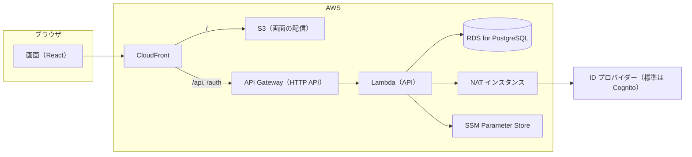

# 設計書: sujigaki（業務設計 SSOT ツール）

| 項目 | 内容 |
|---|---|
| ステータス | Draft |
| 作成日 | 2026-11-19 |
| 要件定義書 | [docs/requirements/business-design-ssot.md](../requirements/business-design-ssot.md) |

## 1. 設計概要

TypeScript のモノレポで、画面・API・ドメインの規則を1つの言語で書く。ドメインの規則（要素の種類、つながりの規則、確認状態の遷移、検証、差分）は I/O を持たないパッケージにまとめ、ブラウザとサーバーの両方で使う。サーバーモードは AWS の Lambda と RDS for PostgreSQL で動かし、ローカルモードは同じサーバーを手元で起動して YAML ファイルを読み書きする。保存先の違いはリポジトリの実装の差し替えで吸収し、ドメインとアプリケーション層は保存先を知らない。

### 1.1 システム構成

- 画面と API は CloudFront で同じオリジンにまとめる。ログインのセッションは暗号化した HttpOnly の Cookie に、利用者の ID と有効期限だけを入れて持つ。ロールはリクエストのたびにデータベースで確かめる。
- ID プロバイダーのクライアントシークレットと、Cookie の暗号化の鍵は、SSM Parameter Store に置く（NFR-007）。
- Lambda は VPC のプライベートサブネットに置く。ID プロバイダーとの通信は NAT インスタンスを経由する（ADR-002）。
- ローカルモードは、`sujigaki` コマンドが手元で API と画面を配信する。データベースと ID プロバイダーは使わない（ADR-003）。
- 開発環境は `docker compose` で、API・画面・PostgreSQL・Keycloak（OIDC プロバイダー）を起動する。AWS アカウントは要らない（NFR-013）。

### 1.2 モジュール構成

| パッケージ | 役割 | 依存してよい先 |
|---|---|---|
| `packages/domain` | モデル・合意・権限の型と規則。I/O を持たない | なし |
| `packages/interchange` | YAML・RDRA 関連データ・AI 向けテキストの変換と、取り込みの差分 | `domain` |
| `apps/server` | API（Hono）。アプリケーション層、保存先の実装（PostgreSQL・ファイル）、OIDC | `domain`, `interchange` |
| `apps/web` | 画面（React、React Flow） | `domain`, `interchange` |
| `apps/cli` | ローカルモードの起動 | `apps/server` |
| `infra` | AWS の環境（AWS CDK） | なし |

依存は表の上から下への一方向とし、`domain` はどこにも依存しない。パッケージをまたぐ循環は、lint の規則で検出する。

### 1.3 主な技術

| 用途 | 技術 |
|---|---|
| 言語 | TypeScript |
| 画面 | React、React Flow（図の描画）、elkjs（自動レイアウト） |
| API | Hono（Lambda と Node.js の両方で動かす） |
| データベース | PostgreSQL、Kysely（SQL の組み立てとマイグレーション） |
| スキーマ | Zod。YAML の形式を公開する JSON Schema も Zod から生成する（FR-050） |
| 認証 | OIDC の認可コードフロー（PKCE 付き）。サーバー側でトークンを交換する |
| IaC | AWS CDK |
| テスト | Vitest、Playwright |
