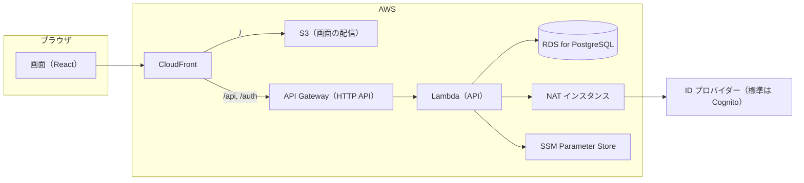
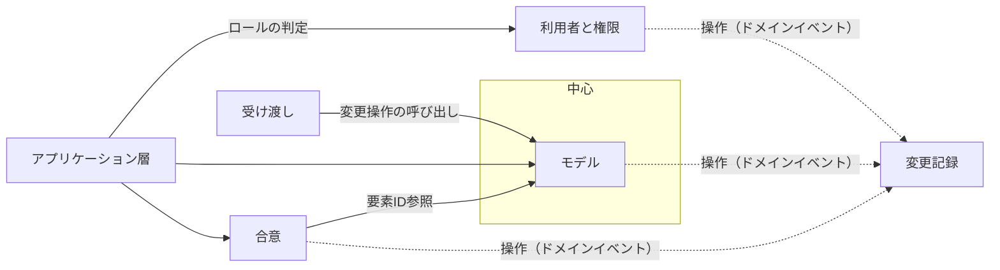
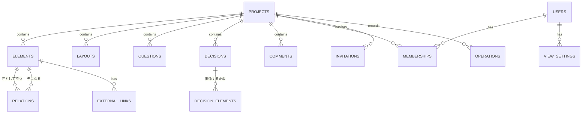
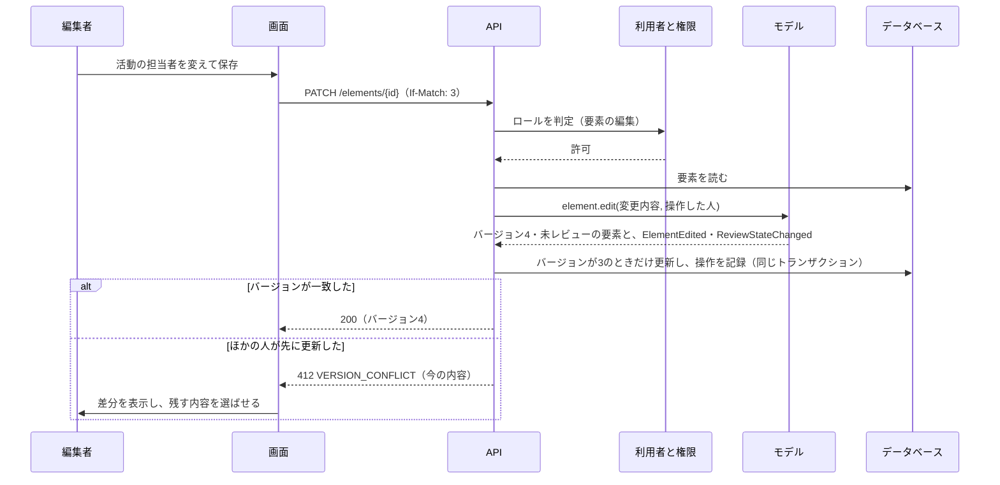
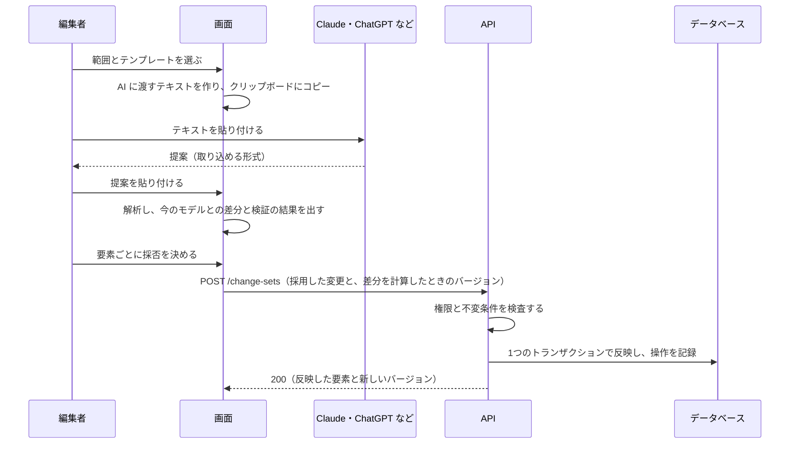
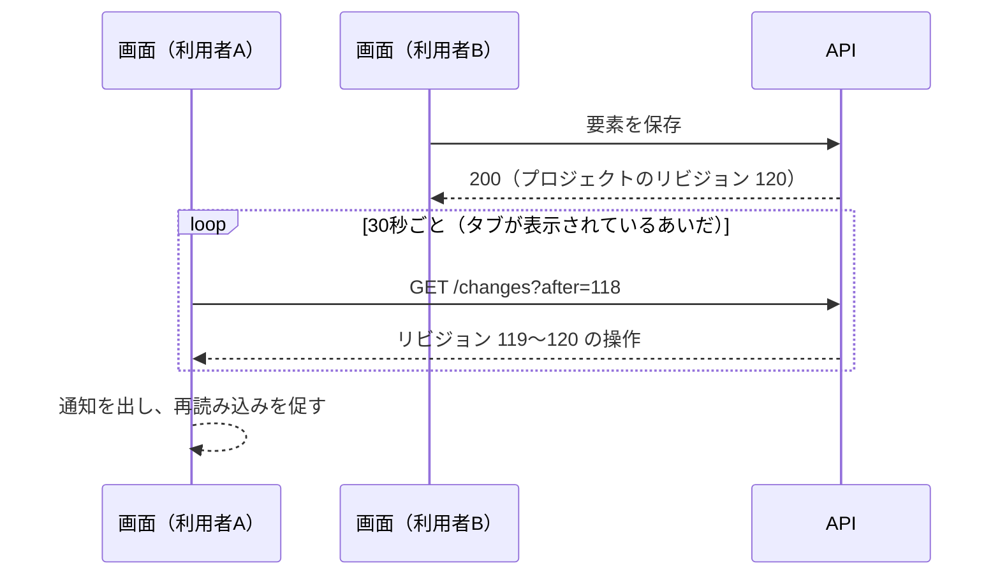
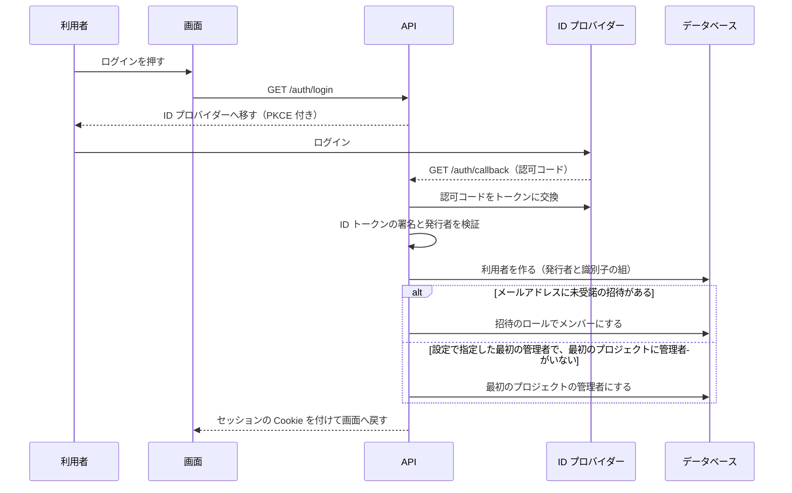

# 設計書: sujigaki（業務設計 SSOT ツール）

| 項目 | 内容 |
|---|---|
| ステータス | Draft |
| 作成日 | 2026-11-19 |
| 要件定義書 | [docs/requirements/business-design-ssot.md](../requirements/business-design-ssot.md) |

## 1. 設計概要

TypeScript のモノレポで、画面・API・ドメインの規則を1つの言語で書く。ドメインの規則（要素の種類、つながりの規則、確認状態の遷移、検証、差分）は I/O を持たないパッケージにまとめ、ブラウザとサーバーの両方で使う。サーバーモードは AWS の Lambda と RDS for PostgreSQL で動かし、ローカルモードは同じサーバーを手元で起動して YAML ファイルを読み書きする。保存先の違いはリポジトリの実装の差し替えで吸収し、ドメインとアプリケーション層は保存先を知らない。

### 1.1 システム構成



- 画面と API は CloudFront で同じオリジンにまとめる。ログインのセッションは暗号化した HttpOnly の Cookie に、利用者の ID と有効期限だけを入れて持つ。ロールはリクエストのたびにデータベースで確かめる。
- ID プロバイダーのクライアントシークレットと、Cookie の暗号化の鍵は、SSM Parameter Store に置く（NFR-007）。
- Lambda は VPC のプライベートサブネットに置く。ID プロバイダーとの通信は NAT インスタンスを経由する（ADR-002）。
- ローカルモードは、`sujigaki` コマンドが手元で API と画面を配信する。データベースと ID プロバイダーは使わない（ADR-003）。
- 開発環境は `docker compose` で、API・画面・PostgreSQL・Keycloak（OIDC プロバイダー）を起動する。AWS アカウントは要らない（NFR-013）。

### 1.2 モジュール構成

| パッケージ | 役割 | 依存してよい先 |
|---|---|---|
| `packages/domain` | モデル・合意・権限の型と規則。I/O を持たない | なし |
| `packages/interchange` | YAML・RDRA 関連データ・AI 向けテキストの変換と、取り込みの差分 | `domain` |
| `apps/server` | API（Hono）。アプリケーション層、保存先の実装（PostgreSQL・ファイル）、OIDC | `domain`, `interchange` |
| `apps/web` | 画面（React、React Flow） | `domain`, `interchange` |
| `apps/cli` | ローカルモードの起動 | `apps/server` |
| `infra` | AWS の環境（AWS CDK） | なし |

依存は表の上から下への一方向とし、`domain` はどこにも依存しない。パッケージをまたぐ循環は、lint の規則で検出する。

### 1.3 主な技術

| 用途 | 技術 |
|---|---|
| 言語 | TypeScript |
| 画面 | React、React Flow（図の描画）、elkjs（自動レイアウト） |
| API | Hono（Lambda と Node.js の両方で動かす） |
| データベース | PostgreSQL、Kysely（SQL の組み立てとマイグレーション） |
| スキーマ | Zod。YAML の形式を公開する JSON Schema も Zod から生成する（FR-050） |
| 認証 | OIDC の認可コードフロー（PKCE 付き）。サーバー側でトークンを交換する |
| IaC | AWS CDK |
| テスト | Vitest、Playwright |

## 2. コンテキストマップ



利用者と権限は、アプリケーション層が操作の前に呼ぶ。モデルと合意は、「誰が、どのロールで操作したか」を値として受け取るだけで、利用者と権限のコンテキストを知らない。

### コンテキスト間の連携一覧

| 発信元 | 宛先 | 経路 | 内容 |
|---|---|---|---|
| 合意 | モデル | 型付き ID | 問い・決定記録・コメントが、対象の要素を `ElementId` で参照する |
| 受け渡し | モデル | 型付き ID と変更操作 | 読み込みや AI の提案から作った変更の一式を、モデルの変更操作として渡す |
| モデル | 変更記録 | ドメインイベント | 要素とつながりの変更、確認状態の変更 |
| 合意 | 変更記録 | ドメインイベント | 問いの状態の変更、決定の記録 |
| 利用者と権限 | 変更記録 | ドメインイベント | 招待、ロールの変更、メンバーの除外 |
| アプリケーション層 | 利用者と権限 | 呼び出し | 操作ごとに、権限の表（FR-081）でロールを判定する |

ドメインイベントは発生した操作と同じトランザクションで操作の記録（`operations` テーブル）に書く。別のプロセスに非同期で渡す処理は、今の要件にはない。

## 3. ドメインモデル

### 要素の種類

要素の種類は次の18種類とする。コードでは RDRA の用語をもとにした識別子を使い、画面では要件定義書 4.1 節の表示名を使う。

| 識別子 | 表示名 | 識別子 | 表示名 |
|---|---|---|---|
| `requirement` | 要求 | `event` | イベント |
| `actor` | 登場人物 | `timer` | 定期処理 |
| `actorGroup` | 登場人物のグループ | `context` | 分類 |
| `externalSystem` | 外部システム | `information` | 情報 |
| `externalSystemGroup` | 外部システムのグループ | `stateModel` | 状態の流れ |
| `business` | 業務 | `state` | 状態 |
| `buc` | 業務フロー | `condition` | 業務ルール |
| `activity` | 活動 | `variation` | 区分 |
| `usecase` | システム操作 | | |
| `screen` | 画面 | | |

項目（属性）は情報の、区分の値はバリエーションの、値オブジェクトとして持つ。関連データでも、この2つは `#attribute` の行として要素の下に置かれるためである。項目や区分の値を変えると、持ち主の情報や区分の内容の編集になる（FR-013）。

### つながりの種類

つながりの種類は、元の要素の種類・先の要素の種類・関連データのタグの組で定義する。定義は [RDRA の関連データ形式の調査](../research/rdra-related-data-format.md) の関係の一覧から、`#attribute`・`#comment`・`#stereotype` の行を除いたものに、次の2つを加える。

- 要求 → 業務（このツール独自の関係）
- 要求 → 登場人物（定義・分析シートの「機能要求」シートの列に合わせる）

定義は `packages/domain` の表として持ち、関連データの読み込み・書き出しと、つながりを作るときの検査の両方で使う。

### 集約一覧

| 集約 | 集約ルート | 含まれるエンティティ/VO | 不変条件 |
|---|---|---|---|
| 要素 | `Element` | 種類ごとの属性（VO）、確認状態（VO）、作成の情報（VO）、外部リンク（エンティティ）、元として持つつながり（エンティティ） | 属性が種類ごとの定義に合う。つながりの種類が元と先の種類の組として定義されている。同じ種類で同じ先へのつながりは1つだけ。内容を編集すると確認状態が未レビューに戻る（FR-013）。確認状態の遷移は要件定義書 7.1 節に従う。削除済みの要素は編集できない |
| 図の配置 | `Layout` | 要素ごとの位置（VO） | 1つの業務フローに1つだけ |
| プロジェクト | `Project` | 設定（VO。システム名、要約の上限） | 要約の上限は1以上 |
| 問い | `Question` | 推奨案（VO）、回答（VO） | 状態の遷移は要件定義書 7.2 節に従う |
| 決定記録 | `Decision` | 関係する要素の ID（VO） | 結論と理由が空でない。関係する要素が1つ以上ある |
| コメント | `Comment` | なし | 本文が空でない |
| メンバー構成 | `ProjectMembers` | メンバー（エンティティ）、招待（エンティティ）、ロール（VO） | 管理者が1人以上いる。1人の利用者が持つロールは1つ |
| 利用者 | `User` | なし | ID プロバイダーと利用者の識別子の組が一意 |
| 操作 | `Operation` | 変更前と変更後の内容（VO） | 追記だけで、変更も削除もしない |

要素の集約について、次の3つを補足する。

- **つながりは元の要素が持つ**: つながりを追加・削除すると、元の要素のバージョンが上がり、確認状態が未レビューに戻る。FR-013 と FR-070 の要件を、1つの集約の中で守れる（ADR-004）。
- **先の要素を削除してもつながりは残す**: 先の要素が削除済みになったつながりは、表示と検証では切れたものとして扱う。削除と同じトランザクションで、そのつながりの元の要素を未レビューに戻す。復元すると、つながりは元どおりに見える（FR-012）。
- **図の配置は要素に含めない**: 位置を動かしても要素のバージョンは上がらず、確認状態も変わらない。内容の編集と、配置の変更が衝突しない。

`activity` の属性（担当者・開始のきっかけ・入力・手順の概要・例外・終了状態・区分）と、`requirement` の属性（根拠・発生源・優先度・要望の原文）は、種類ごとの属性として持つ（ADR-005）。担当者は登場人物へのつながりで表し、文字列では持たない。

### 未解決の問いの自動作成

FR-035 の問いは検証（FR-040）と同じく、モデルから毎回計算して確認ボードに出す。保存はしない。利用者が回答したときに、問いの集約として保存する。空欄が埋まれば、計算した問いは消える。

問いを作る空欄は業務の流れを読むのに欠かせない次の項目に絞る。手順の概要や例外のような補足の項目からは作らない。

| 要素の種類 | 空欄 | 問い |
|---|---|---|
| 活動 | 担当者（登場人物へのつながり） | 担当者は誰ですか |
| 活動 | 区分 | この活動は手作業ですか、システムを使いますか |
| 活動 | 開始のきっかけ | この活動は何をきっかけに始まりますか |
| 活動 | 終了状態 | この活動が終わったとき、どういう状態になっていますか |
| 要求 | 根拠 | この要求の根拠は何ですか |

同じ要素に同じ本文の問いがすでに保存されていれば、その問いの状態にかかわらず計算した問いには出さない。取り下げた問いを、空欄のままだからといって何度も出さないためである。

### ドメインイベント

| イベント名（過去形） | 発生タイミング | 購読者 |
|---|---|---|
| `ElementCreated` | 要素を作成した | 変更記録 |
| `ElementEdited` | 名前・要約・属性・外部リンクを変えた | 変更記録 |
| `RelationAdded` / `RelationRemoved` | つながりを追加・削除した | 変更記録 |
| `ReviewStateChanged` | 確認状態が変わった（自動で未レビューに戻った場合を含む） | 変更記録 |
| `ElementDeleted` | 要素を論理削除した | モデル（切れたつながりの元の要素を未レビューに戻す）、変更記録 |
| `ElementRestored` / `ElementPurged` | 要素を復元した／完全に削除した | 変更記録 |
| `LayoutChanged` | 図の配置を保存した | 変更記録 |
| `ProjectSettingsChanged` | プロジェクトの設定を変えた | 変更記録 |
| `QuestionAsked` / `QuestionAnswered` / `QuestionAnswerRetracted` / `QuestionResolved` / `QuestionWithdrawn` | 問いを作成した、回答した、回答を取り消した、解決した、取り下げた | 変更記録 |
| `DecisionRecorded` | 決定を記録した | 変更記録 |
| `MemberInvited` / `InvitationCancelled` / `InvitationAccepted` / `MemberRoleChanged` / `MemberRemoved` | 招待した、招待を取り消した、招待を受けてメンバーになった、ロールを変えた、除外した | 変更記録 |

### 保存先（リポジトリ）

アプリケーション層はプロジェクトの中身（要素・問い・決定記録・図の配置・設定）を `ProjectRepository` で読み書きする。保存先ごとに次の実装を用意し、アプリケーション層は保存先を知らない。

| 実装 | 使う場面 | 保存先 |
|---|---|---|
| PostgreSQL | サーバーモード | 4章のテーブル |
| ファイル | ローカルモード | 5.4 節のフォルダー |
| メモリ | テスト | プロセスのメモリ |

| 操作 | 内容 |
|---|---|
| `create` | 空のプロジェクトを作る。同じ ID のプロジェクトがあれば失敗する |
| `load` | プロジェクトの中身と、プロジェクトのリビジョンを返す。なければ `null` を返す |
| `commit` | 変更の一式を1つのトランザクションで保存し、新しいリビジョンを返す |

`commit` に渡す変更の一式には集約ごとに保存する内容と、読み込んだときのバージョン（新しく作るものは `null`）を入れる。1件でもバージョンが今のものと違えば `VERSION_CONFLICT` を返し、何も保存しない。同じ変更の一式に、操作の記録（`operations` に書く内容）も入れる。問いと決定記録はバージョンを持たないため、問いは上書きし、決定記録は新しく作るだけにする。図の配置は保存する前のバージョンを0として扱う。

- 変更の一式は画面の1回の保存や、取り込みの1回の反映にあたる。操作の記録には同じ `batch_id` を付ける。
- 同時に `commit` を呼んでも、同じバージョンへの更新は1件だけが成功する（NFR-005）。PostgreSQL の実装はバージョンを条件にした UPDATE で、ファイルとメモリの実装はプロセスの中で順番に処理して守る。
- ファイルの実装は最後に読み書きしたときのファイルの内容のハッシュと中身を覚えておく。外部のエディターや `git pull` でファイルが変わっていれば、内容が変わった要素と図の配置のバージョンを1つ進め、プロジェクトのリビジョンも1つ進める（5.4 節）。古いバージョンのまま保存しようとした画面には `VERSION_CONFLICT` を返し、リビジョンの変化で再読み込みを促す。操作の記録はファイルに書かず、変更履歴は Git の履歴を使う（FR-072）。
- 利用者・メンバー構成・コメント・表示の設定は、サーバーモードだけで使う別のリポジトリに置く。

## 4. DB設計

サーバーモードのデータベースは PostgreSQL とする（ADR-001）。ローカルモードはデータベースを使わず、5.4 節の YAML ファイルに保存する。



### テーブル定義

ID は、プロジェクトと利用者は UUID、それ以外は ULID（26文字の文字列）とする。要素とつながりの ID は、ローカルモードやブラウザでの取り込みでも作るため、サーバーに頼らずに作れる ULID にした。日時はすべて `timestamptz` とする。

`projects`

| カラム | 型 | 制約 |
|---|---|---|
| id | uuid | PK |
| name | text | NOT NULL |
| system_name | text | NOT NULL。関連データの1行目に書き出す |
| summary_max_length | integer | NOT NULL, DEFAULT 100, CHECK (summary_max_length > 0)（FR-005） |
| created_at | timestamptz | NOT NULL |

`elements`

| カラム | 型 | 制約 |
|---|---|---|
| id | text | PK。ULID |
| project_id | uuid | NOT NULL, FK projects |
| kind | text | NOT NULL, CHECK（3章の18種類） |
| name | text | NOT NULL, CHECK (length(name) BETWEEN 1 AND 200) |
| summary | text | NOT NULL, DEFAULT ''。上限を超えても保存できる（FR-005） |
| attributes | jsonb | NOT NULL, DEFAULT '{}'。種類ごとの属性（ADR-005） |
| review_state | text | NOT NULL, CHECK (review_state IN ('unreviewed', 'needs_check', 'needs_fix', 'approved')) |
| reviewed_hash | text | NULL。確認状態を変えたときの内容のハッシュ（FR-041）。未レビューに戻ると空にする |
| author_type | text | NOT NULL, CHECK (author_type IN ('human', 'ai', 'import')) |
| source | text | NULL。出所（「AI 提案」「RDRA 読み込み」と、取り込みの日時） |
| version | integer | NOT NULL, DEFAULT 1。楽観ロックのバージョン（FR-070） |
| deleted_at | timestamptz | NULL。論理削除（FR-012） |
| deleted_by | uuid | NULL, FK users |
| created_at / updated_at | timestamptz | NOT NULL |
| created_by / updated_by | uuid | NULL, FK users |

要素の名前は一意にしない。業務フローが違えば、同じ名前の活動がありうるためである。関連データに書き出すときに名前が重なる場合は、書き出しの前に警告する。

`relations`

| カラム | 型 | 制約 |
|---|---|---|
| id | text | PK。ULID |
| project_id | uuid | NOT NULL, FK projects |
| type | text | NOT NULL。つながりの種類（例: `activity-usecase`） |
| from_element_id | text | NOT NULL, FK elements ON DELETE CASCADE |
| to_element_id | text | NOT NULL, FK elements ON DELETE CASCADE |
| created_at | timestamptz | NOT NULL |
| created_by | uuid | NULL, FK users |
| | | UNIQUE (from_element_id, to_element_id, type) |

元と先の要素の種類の組がつながりの種類に合うかは、要素の集約で検査する。データベースでは検査しない。

`external_links`

| カラム | 型 | 制約 |
|---|---|---|
| id | text | PK |
| element_id | text | NOT NULL, FK elements ON DELETE CASCADE |
| kind | text | NOT NULL, CHECK (kind IN ('manual', 'spec', 'design', 'ticket', 'other')) |
| url | text | NOT NULL, CHECK (url ~ '^https?://') |
| label | text | NULL |
| position | integer | NOT NULL。表示の順 |

`layouts`

| カラム | 型 | 制約 |
|---|---|---|
| project_id | uuid | NOT NULL, FK projects |
| buc_id | text | NOT NULL, FK elements ON DELETE CASCADE |
| positions | jsonb | NOT NULL。要素 ID ごとの座標 |
| version | integer | NOT NULL |
| updated_at | timestamptz | NOT NULL |
| | | PK (project_id, buc_id) |

`questions`

| カラム | 型 | 制約 |
|---|---|---|
| id | text | PK |
| project_id | uuid | NOT NULL, FK projects |
| element_id | text | NOT NULL。モデルのコンテキストへの ID 参照のため、FK は張らない |
| body | text | NOT NULL |
| recommendation | text | NULL。推奨案 |
| state | text | NOT NULL, CHECK (state IN ('open', 'answered', 'resolved', 'withdrawn')) |
| answer | text | NULL |
| answered_by / answered_at | uuid / timestamptz | NULL |
| author_type | text | NOT NULL, CHECK (author_type IN ('human', 'ai', 'auto')) |
| created_at / created_by | timestamptz / uuid | NOT NULL / NULL |
| | | CHECK (state IN ('open', 'withdrawn') OR answer IS NOT NULL) |

`decisions` と `decision_elements`

| テーブル | カラム | 型 | 制約 |
|---|---|---|---|
| decisions | id | text | PK |
| | project_id | uuid | NOT NULL, FK projects |
| | question_id | text | NULL, FK questions |
| | topic | text | NOT NULL。何についての決定か |
| | conclusion / reason | text | NOT NULL |
| | decided_by | uuid | NOT NULL, FK users |
| | decided_at | timestamptz | NOT NULL |
| decision_elements | decision_id | text | NOT NULL, FK decisions ON DELETE CASCADE |
| | element_id | text | NOT NULL。ID 参照のため FK は張らない |
| | | | PK (decision_id, element_id) |

`view_settings`

| カラム | 型 | 制約 |
|---|---|---|
| user_id | uuid | NOT NULL, FK users |
| project_id | uuid | NOT NULL, FK projects |
| settings | jsonb | NOT NULL。選んだプリセットと、種類ごとの表示・非表示（FR-022） |
| updated_at | timestamptz | NOT NULL |
| | | PK (user_id, project_id) |

`comments`

| カラム | 型 | 制約 |
|---|---|---|
| id | text | PK |
| project_id | uuid | NOT NULL, FK projects |
| element_id | text | NOT NULL。ID 参照のため FK は張らない |
| body | text | NOT NULL, CHECK (length(body) > 0) |
| author_id | uuid | NOT NULL, FK users |
| created_at | timestamptz | NOT NULL |

`users`、`memberships`、`invitations`

| テーブル | カラム | 型 | 制約 |
|---|---|---|---|
| users | id | uuid | PK |
| | issuer / subject | text | NOT NULL, UNIQUE (issuer, subject) |
| | email | text | NOT NULL |
| | display_name | text | NOT NULL |
| memberships | project_id | uuid | NOT NULL, FK projects |
| | user_id | uuid | NOT NULL, FK users |
| | role | text | NOT NULL, CHECK (role IN ('viewer', 'editor', 'owner', 'admin')) |
| | | | PK (project_id, user_id) |
| invitations | id | uuid | PK |
| | project_id | uuid | NOT NULL, FK projects |
| | email | text | NOT NULL |
| | role | text | NOT NULL, CHECK（memberships と同じ） |
| | invited_by | uuid | NOT NULL, FK users |
| | created_at / accepted_at | timestamptz | NOT NULL / NULL |
| | | | 未受諾の招待は、プロジェクトとメールアドレス（小文字にしたもの）の組で一意 |

ロールの `owner` は業務責任者を表す。

`operations`

| カラム | 型 | 制約 |
|---|---|---|
| id | bigint | PK, GENERATED ALWAYS AS IDENTITY。プロジェクトのリビジョンとしても使う |
| project_id | uuid | NOT NULL, FK projects |
| batch_id | text | NOT NULL。1回の保存や取り込みでまとめて行った操作に同じ値を付ける |
| actor_id | uuid | NULL, FK users |
| occurred_at | timestamptz | NOT NULL |
| type | text | NOT NULL。ドメインイベントの名前 |
| target_type / target_id | text | NOT NULL |
| before / after | jsonb | NULL。変更前と変更後の内容 |

アプリケーションがデータベースに接続するユーザーには、`operations` への INSERT と SELECT だけを許可し、UPDATE と DELETE は許可しない（NFR-008）。変更履歴（FR-072）と監査（NFR-008）は、どちらもこのテーブルから取り出す。要素を完全に削除しても、操作の記録は残す。

### 保持期間

- 操作の記録（変更履歴と監査）は、期限を設けずに残す。編集の頻度が低く、10人が毎日編集しても年に数万行にとどまる見込みのためである。保持期間を短くする設定は、必要になってから追加する。
- データベースの自動バックアップは7日分残す（NFR-010）。
- アプリケーションのログは CloudWatch Logs に90日残す（NFR-012）。

### インデックス

| テーブル | インデックス | 根拠となる想定クエリ |
|---|---|---|
| elements | (project_id) | プロジェクトを開くときに、全要素を取り出す（NFR-001）。削除済みの一覧（FR-012）も同じインデックスで絞る |
| relations | (project_id) | プロジェクトを開くときに、全つながりを取り出す |
| relations | (to_element_id) | 要素を削除するときに、その要素を先とするつながりの元の要素を探す（FR-012、FR-013） |
| relations | UNIQUE (from_element_id, to_element_id, type) | 重複したつながりを防ぐ。元の要素のつながりの取り出しにも使う |
| external_links | (element_id) | 要素と一緒に外部リンクを取り出す |
| operations | (project_id, id) | 指定したリビジョンより後の変更を取り出す（FR-071）。プロジェクトの変更履歴を新しい順に見る |
| operations | (target_id, id) | 要素ごとの変更履歴を見る（FR-072） |
| questions | (project_id) | プロジェクトを開くときに、問いを取り出す |
| decision_elements | (element_id) | 要素に結び付いた決定記録を見る |
| comments | (element_id, created_at) | 要素のコメントを古い順に見る |
| memberships | (user_id) | ログインした利用者が参加しているプロジェクトの一覧を出す（FR-060） |

## 5. API設計

API は `/api` の下に置き、JSON でやり取りする。ローカルモードでも同じ API を使う。ローカルモードではログインせず、利用者は常に管理者として扱う。

### 5.1 エンドポイント一覧

| メソッド | パス | 概要 | 要件ID |
|---|---|---|---|
| GET | /auth/login | ID プロバイダーのログイン画面へ移る | FR-080 |
| GET | /auth/callback | 認可コードをトークンに交換し、セッションを作る | FR-080 |
| POST | /auth/logout | セッションを終える | FR-080 |
| GET | /api/me | ログインしている利用者と、参加しているプロジェクトのロール | FR-080, FR-081 |
| GET | /api/projects | 参加しているプロジェクトの一覧 | FR-060 |
| POST | /api/projects | プロジェクトを作る | FR-090 |
| PATCH | /api/projects/{projectId} | プロジェクトの設定を変える | FR-005 |
| GET | /api/projects/{projectId}/snapshot | 有効な要素・つながり・外部リンク・図の配置・問い・決定記録と、プロジェクトのリビジョンをまとめて返す | FR-020〜026, NFR-001 |
| GET | /api/projects/{projectId}/changes?after={リビジョン} | 指定したリビジョンより後の操作を返す | FR-071 |
| POST | /api/projects/{projectId}/elements | 要素を作る | FR-010 |
| PATCH | /api/projects/{projectId}/elements/{elementId} | 要素を編集する。`If-Match` にバージョンを付ける | FR-010, FR-013, FR-070 |
| DELETE | /api/projects/{projectId}/elements/{elementId} | 要素を論理削除する | FR-012 |
| POST | /api/projects/{projectId}/elements/{elementId}/restore | 要素を復元する | FR-012 |
| POST | /api/projects/{projectId}/elements/{elementId}/purge | 削除済みの要素を完全に削除する | FR-012 |
| GET | /api/projects/{projectId}/elements?deleted=true | 削除済みの要素の一覧 | FR-012 |
| POST | /api/projects/{projectId}/elements/{elementId}/relations | つながりを追加する。`If-Match` に元の要素のバージョンを付ける | FR-010, FR-013 |
| DELETE | /api/projects/{projectId}/elements/{elementId}/relations/{relationId} | つながりを削除する。`If-Match` に元の要素のバージョンを付ける | FR-010, FR-013 |
| POST | /api/projects/{projectId}/elements/{elementId}/review-state | 確認状態を変える | FR-030 |
| GET | /api/projects/{projectId}/elements/{elementId}/history | 要素の変更履歴 | FR-072 |
| PUT | /api/projects/{projectId}/layouts/{bucId} | 業務フローの図の配置を保存する。`If-Match` に配置のバージョンを付ける | FR-020 |
| POST | /api/projects/{projectId}/change-sets | 変更の一式をまとめて反映する | FR-034, FR-050, FR-052 |
| POST | /api/projects/{projectId}/restore | 空のプロジェクトに、YAML の内容を復元する | FR-050 |
| POST | /api/projects/{projectId}/questions | 問いを作る | FR-031, FR-035 |
| POST | /api/projects/{projectId}/questions/{questionId}/state | 問いに回答する、回答を取り消す、解決する、取り下げる | FR-031 |
| POST | /api/projects/{projectId}/decisions | 決定を記録する | FR-032 |
| GET | /api/projects/{projectId}/elements/{elementId}/comments | 要素のコメントの一覧 | US-009 |
| POST | /api/projects/{projectId}/elements/{elementId}/comments | コメントを書く | US-009 |
| GET | /api/projects/{projectId}/view-settings | 自分の表示の設定を返す | FR-022 |
| PUT | /api/projects/{projectId}/view-settings | 自分の表示の設定を保存する | FR-022 |
| GET | /api/projects/{projectId}/members | メンバーと招待の一覧 | FR-082 |
| POST | /api/projects/{projectId}/invitations | メンバーを招待する | FR-082 |
| DELETE | /api/projects/{projectId}/invitations/{invitationId} | 招待を取り消す | FR-082 |
| PATCH | /api/projects/{projectId}/members/{userId} | ロールを変える | FR-082 |
| DELETE | /api/projects/{projectId}/members/{userId} | メンバーを除外する | FR-082 |

次の処理は API を持たず、ブラウザで `packages/domain` と `packages/interchange` を使って行う。

- 表示（業務フロー、連鎖ビュー、確認ボード、トレース表）と検索（FR-020〜026）。スナップショットから描画する。
- 検証（FR-040）と、空欄からの問いの計算（FR-035）
- AI に渡すテキストの作成（FR-033）
- YAML と関連データの書き出し（FR-050、FR-051）。スナップショットから作る。
- 読み込みと AI の提案の解析、差分の計算（FR-034、FR-050、FR-052）。利用者が採用した変更だけを、変更の一式として `change-sets` に送る。

`change-sets` は変更の一式を1つのトランザクションで反映する。要素ごとに、差分を計算したときのバージョンを付けて送り、1件でもバージョンが合わなければ全体を反映しない。サーバーは権限の判定と集約の不変条件の検査をもう一度行う。

権限の判定（FR-081）はすべてのエンドポイントでサーバー側で行う。操作とロールの対応は `packages/domain` の表として持ち、画面のボタンの表示にも同じ表を使う。

状態を変える操作（確認状態、問いの状態）は、動詞のエンドポイントにまとめ、変更先の状態を本文で送る。

問いの状態を変える API は本文の `action` に `answer`・`acceptRecommendation`・`retract`・`resolve`・`withdraw` のどれかを入れる。どの操作ができるかは、要件定義書 7.2 節の遷移とロールで問いの集約が決める。問いを作る操作は FR-081 の表にないため、回答と同じ閲覧者以上とする。空欄から計算した問い（FR-035）は、閲覧者が回答したときに保存するためである。

要素を変える API（編集・削除・復元・完全な削除・つながりの追加と削除・確認状態の変更）は、すべて `If-Match` に読み込んだときの要素のバージョンを付けて呼ぶ。付いていなければ `VALIDATION_FAILED` を返す。成功したら、`ETag` に新しいバージョンを入れて返す。完全な削除は削除済みの要素だけに行え、削除していない要素には `INVALID_TRANSITION` を返す。完全に削除すると復元できないため、ほかの要素からその要素へのつながりも同じ保存で外し、外した要素のバージョンを上げる。削除済みの要素からのつながりも外す。問いと決定記録は検討の記録として残す。図の配置に残る位置は、要素がないため描かない。スナップショットには削除済みの要素を含めない。削除済みの要素は `GET /elements?deleted=true` で取り、本文の `elements` に削除した日時の新しい順で入れる。`deleted=true` を付けずに呼ぶと `VALIDATION_FAILED` を返す。

`GET /changes?after={リビジョン}` は、指定したリビジョンより後の操作を古い順に最大200件、本文の `operations` に入れて返す。操作ごとに、種類・対象・操作した人・日時と、その操作で進んだあとのリビジョンを入れる。変更の前後の内容は入れない。本文の `revision` には今のリビジョンを入れる。200件を超えるときは、最後の操作のリビジョンを `after` にして続きを取る。ローカルモードでは、ファイルが外で変わったことを種類 `ExternalChange` の操作として返す（5.4 節）。`after` が今のリビジョンより大きいとき（サーバーを起動し直したときなど）は、操作を空にして今のリビジョンを返す。

状態を変えるリクエストには `X-Sujigaki-Request: 1` ヘッダーを必須とし、Cookie の SameSite=Lax と合わせて CSRF を防ぐ。

### 5.2 エラーレスポンス規約

エラーは RFC 9457 の形式（`application/problem+json`）で返し、`code` に次のコードを入れる。

```json
{
  "type": "urn:sujigaki:problem:version-conflict",
  "title": "ほかの人が先に更新しました",
  "status": 412,
  "code": "VERSION_CONFLICT",
  "detail": "要素「申込内容を確認する」はバージョン 4 に更新されています。",
  "current": { "id": "01J...", "version": 4 }
}
```

| code | status | 使う場面 |
|---|---|---|
| `UNAUTHENTICATED` | 401 | ログインしていない、セッションが切れた |
| `FORBIDDEN` | 403 | ロールに操作の権限がない |
| `NOT_FOUND` | 404 | 対象がない、または参加していないプロジェクト |
| `VALIDATION_FAILED` | 400 | 入力の形式が誤っている。`errors` に項目ごとの理由を入れる |
| `RELATION_NOT_ALLOWED` | 422 | 定義されていない種類の組でつながりを作ろうとした（FR-001） |
| `INVALID_TRANSITION` | 422 | 確認状態や問いの状態の遷移が定義にない |
| `RELATION_EXISTS` | 409 | 同じつながりがすでにある |
| `ELEMENT_DELETED` | 409 | 削除済みの要素を編集しようとした |
| `LAST_ADMIN` | 409 | 最後の管理者を除外する、またはロールを変えようとした |
| `PROJECT_NOT_EMPTY` | 409 | 要素があるプロジェクトに復元しようとした（FR-050） |
| `VERSION_CONFLICT` | 412 | `If-Match` のバージョンが今のバージョンと違う（FR-070）。`current` に今の内容を入れ、画面で差分を出す |
| `INTERNAL` | 500 | 予期しないエラー。詳細はログにだけ残す |

`type` には `code` に対応する URN を入れる。

### 5.3 ページネーション方針

- スナップショットは分けずに返す。要素1万件・つながり2万件でも、圧縮すれば数 MB に収まる見込みである（NFR-001）。数万件を超えたら、業務の単位で取り出す引数（`?businessId=`）を加える（NFR-003）。
- 変更履歴・コメント・削除済みの一覧・変更の取り出しは、カーソル方式とする。カーソルは `operations.id` などの単調に増える値をもとにした不透明な文字列とする。既定の件数は50件、上限は200件。

### 5.4 ローカルモードのファイル構成

ローカルモードでは指定したフォルダーに次の構成で YAML ファイルを置く（ADR-006）。

```text
<フォルダー>/
  sujigaki.yaml                 形式の版、システム名、設定
  requirements.yaml             要求
  actors.yaml                   登場人物・登場人物のグループ・外部システム・外部システムのグループ
  businesses/<業務の ID>.yaml    業務と、その下の業務フロー・活動
  system/usecases.yaml          システム操作
  system/screens.yaml           画面
  system/events.yaml            イベント
  system/timers.yaml            定期処理
  contexts/<分類の ID>.yaml      分類と、その下の情報・状態の流れ・状態・業務ルール・区分
  deliberation.yaml             問い・決定記録
  layouts/<業務フローの ID>.yaml  図の配置
```

- つながりは、元の要素の項目の下に書く。集約の境界と同じにするためである。
- 業務や分類に属さない要素は、`businesses/unassigned.yaml` と `contexts/unassigned.yaml` に置く。
- 業務フローはそれを持つ業務のファイルに、活動はその業務フローを持つ業務のファイルに置く。状態はそれを持つ状態の流れの分類のファイルに置く。親が2つ以上あるときは、ID の小さい親のファイルに置く。
- 業務と分類のファイルの先頭には、その名前をコメントで書く（ADR-006）。
- 要素の書き方は 5.5 節と同じにする。読み込むときは要素がどのファイルにあっても読み込み、次に書き出すときに決まったファイルへ移す。上の構成にないファイル（README など）は読まない。
- ID はファイル名にも使うため、英数字と「-」「_」に限る。
- ファイルの中の要素は ID の順に並べ、項目の順も固定する。保存のたびに並びが変わって、Git の差分が大きくならないようにする。
- 外部のエディターや `git pull` でファイルが変わったことは、最後に読み書きしたときのファイルの内容のハッシュと比べて見つける。変わった要素は、ほかの人が先に更新したときと同じく競合として扱い、再読み込みを促す（3章の「保存先（リポジトリ）」）。見つけたときは、種類 `ExternalChange` の操作を1件、メモリに記録する。画面はこの操作で外の変更を知らせる（FR-071）。メモリに記録した操作はサーバーを止めると消える。
- エディターや `git pull` がファイルを書いている途中に読むと、書きかけの内容を読むことがある。そのため、前回と内容が違っていたら100ミリ秒待って読み直し、2回続けて同じ内容になってから使う。読み直しは10回までとし、それでも内容が落ち着かなければ最後に読んだ内容を使う。落ち着いた内容が YAML として読めないときだけ、読み込みのエラーにする。
- 要素へのコメントと変更履歴は持たない。変更履歴は Git の履歴を使う（FR-072）。
- 表示の設定（FR-022）はファイルに書かず、ブラウザに保存する。

ローカルモードは `sujigaki <フォルダー>` で起動する。フォルダーにプロジェクトがなければ、フォルダーの名前で作る。ログインがないため `127.0.0.1` で待ち受け、`127.0.0.1` と `localhost` 以外のホスト名で届いたリクエストは断る。ほかのサイトから DNS rebinding で API を呼ばれないようにするためである。

### 5.5 書き出す YAML の形式

FR-050 の書き出しではモデル全体を1つの YAML ファイルにまとめる。形式は `packages/interchange` の Zod のスキーマで定義し、そこから作った JSON Schema を `packages/interchange/schema/project.schema.json` に置く。

```yaml
format: sujigaki
version: 1            # 形式のバージョン（NFR-015）
project:
  name: 申込管理
  systemName: 申込システム
elements:
  - id: act1
    kind: activity
    name: 申込内容を確認する
    attributes:
      mode: system
    reviewState: approved
    reviewedHash: 3f9c0a1b2d4e5f   # 確認状態を変えたときの内容のハッシュ（FR-041）
    authorType: human
    relations:
      - id: r1
        type: activity-usecase
        to: uc1
    version: 3
    createdAt: 2026-11-19T00:00:00.000Z
    updatedAt: 2026-11-19T01:00:00.000Z
questions: []
decisions: []
layouts: []
```

- 既定の値と同じ項目（空の要約、空の属性、つながりのない要素の `relations` など）は書き出さず、読み込むときに既定の値で補う。
- つながりは種類と先の要素の ID で書き、先の要素の種類は種類から求める。
- `reviewedHash` は、確認状態を未レビュー以外に変えたときに、内容（名前・要約・属性・つながりの種類と先）から求めて記録する。読み込んだ今の内容から求めた値と違えば、検証（FR-041）で「確認したあとに内容が変わった」と知らせる。手で書き換えれば一致させられるため、うっかりの変更を見つけるための値であり、改ざんは防がない。外部リンクは確認状態を戻さない（FR-013）ため、ハッシュに含めない。ブラウザとサーバーの両方で同じ値を求めるため、暗号用ではない53ビットのハッシュを16進数で書く。
- 業務の範囲を書き出すときは、`scope.businessId` に業務の ID を書く。範囲は AI に渡す範囲（FR-033）と同じく、業務・その業務フローと活動・それらに直接つながる要素とする。問いはこの範囲の要素のもの、決定記録はこの範囲の要素を1つでも含むもの、図の配置はこの範囲の業務フローのものを書き出す。範囲の外の要素へのつながりも書き出し、読み込んだ先では検証（FR-040）で知らせる。
- `scope` のあるファイルを要素のあるプロジェクトに取り込むときは、今のモデルでその業務の範囲にある要素だけを、ファイルにないときに削除の変更にする。空のプロジェクトへの復元では `scope` を使わない。
- 削除済みの要素も `deletedAt` を付けて書き出す。ローカルモードで、削除済みの一覧から復元できるようにするためである。
- 読み込むときは、スキーマに加えて、ID の重なりと、元の要素の種類が持てないつながりを確かめる。合わない箇所は YAML の中の位置と行番号を付けてすべて返し、モデルは変えない。先の要素がないつながりは拒否せず、検証（FR-040）で知らせる。
- 対応しているより新しいバージョンの形式は読み込まず、sujigaki の更新を促す。形式を変えるときはバージョンを上げ、古いバージョンを変換する処理を足す。古いバージョンのファイルはテストのデータとして `packages/interchange/fixtures/` に残す。

ローカルモードのフォルダー（5.4 節）にも、要素は同じ書き方で置く。

### 5.6 復元と取り込み

YAML の読み込みは読み込み先によって次の2つに分ける（FR-050）。どちらも `packages/interchange` の関数として持ち、ブラウザとサーバーの両方で使う。

- **空のプロジェクトへの復元**（`restoreDocument`）: 業務責任者以上とローカルモードは、確認状態を保ったまま復元する。編集者が復元するときは、すべての要素を未レビューにする。空のプロジェクトかどうかは API で確かめ、要素があれば `PROJECT_NOT_EMPTY` を返す。
- **既存のプロジェクトへの取り込み**（`diffElements`、`applyImport`）: 要素を ID で対応させて差分を出し、利用者が採用した変更だけを当てる。AI の提案の取り込み（FR-034）も同じ関数を使う。

差分は追加・変更・削除を要素ごとに1件ずつ出す。比べるのは名前・要約・属性・外部リンク・つながりで、取り込む側の確認状態・バージョン・日時は使わない。つながりは種類と先の要素の組で比べ、ID の違いは無視する。

- 取り込む側にない要素を削除にするのは、モデル全体を書き出したファイルを取り込むときだけにする。AI の提案のように一部だけを渡すときは、削除にしない。
- 今は削除済みの要素を取り込むと、復元してから内容を変える。
- 要素の種類が違うものは変更にせず、取り込めない要素として一覧に出す。

採用した変更は要素の集約の操作（作成・編集・外部リンクの置き換え・つながりの追加と削除・削除・復元）に置き換えて当てる。集約の操作を通すため、内容やつながりが変わった要素は未レビューに戻り、外部リンクだけの変更では戻らない（FR-013）。削除した要素へのつながりを持つ要素も未レビューに戻す。追加した要素の作成者の種類は、AI の提案なら `ai`、ファイルの読み込みなら `import` にする。

変更には差分を出したときの要素のバージョンを付ける。当てるときにバージョンが違えば `VERSION_CONFLICT` を返し、1件でも当てられなければ何も反映しない。`change-sets`（5.1 節）はこの結果を1つのトランザクションで保存する。

`POST /restore` は本文の `yaml` に YAML の文字列を入れる。`POST /change-sets` は本文の `changes` に追加・変更・削除を1件ずつ入れ、`origin` に作成者の種類（`ai` か `import`）と出所を入れる。変更と削除には、差分を出したときの要素のバージョンを `baseVersion` に入れる。確認状態・バージョン・日時は送らず、サーバーが今の要素から決める。つながりの先の種類も送らず、つながりの種類から求める。

### 5.7 AI との受け渡し

AI に渡すテキスト（FR-033）と、AI の返答の形式（FR-034）は `packages/interchange` で作り、読む。AI の API は呼ばず、利用者がクリップボードを使って受け渡す。

AI に渡すテキストは次の順にまとめる。

1. 依頼: 用途のテンプレート（下書きの作成・抜け漏れの指摘・質問の作成）ごとの依頼の文。利用者が補足を書いたときは、そのあとに「補足」として続ける
2. 規則: 要素の種類と表示名、範囲の種類どうしでつなげるつながりの種類、種類ごとの属性。用途が下書きの作成のときと、範囲がプロジェクト全体のときは、範囲にない種類も含めて、すべての種類とつながりの種類を書く。下書きでは範囲にない種類の要素を新しく作るためである
3. 範囲の要素: 5.5 節の YAML の要素の書き方で書く。範囲がプロジェクト全体なら、有効な要素をすべて書く。要素がないプロジェクトでも選べる。範囲が業務なら、業務とその下の業務フロー・活動に加えて、それらに直接つながる要素を含める
4. 未解決の問い: 範囲の要素の未回答の問いと、空欄から計算した問い（FR-035）
5. 返答形式: 次の形式の YAML だけを返すよう指示する

```yaml
format: sujigaki-proposal
version: 1
elements:          # 追加・変更する要素。変更する要素は、つながりも含めて全体を書く
  - id: new-1      # 既存の要素は同じ ID、新しい要素は new- で始まる ID
    kind: activity
    name: 申込内容を確認する
    attributes: { mode: manual }
    relations:
      - { type: activity-actor, to: actor1 }
questions:         # 質問の作成のときに使う
  - { elementId: act1, body: 例外のときは誰に連絡しますか, recommendation: 研修担当 }
```

- 返答は確認状態・バージョン・日時を持たない。読み込むときに、確認状態は未レビュー、作成者の種類は AI にする。
- 返答がコードブロック（```yaml）で囲まれていても読む。
- `new-` で始まる ID と、今のモデルにない ID の要素は、新しい要素として扱い、取り込むときにツールが新しい ID を付ける。提案の中のつながりの先と問いの要素も、付けた ID に合わせる。AI は回をまたいで同じ仮の ID を使うため、仮の ID のまま残すと、次の提案の新しい要素が既存の要素の変更として扱われるからである。
- 返答にない要素は削除の変更にしない（5.6 節の `removeMissing` は false）。
- 形式に合わない返答は合わない箇所を行番号付きで返し、取り込まない。

### 5.8 関連データの書き出し

RDRA の関連データ（FR-051）は `packages/interchange` でスナップショットから作る。形式は [RDRA の関連データ形式の調査](../research/rdra-related-data-format.md) による。

- 1行目にプロジェクトのシステム名を書く。2行目以降は関係の行で、タグ・元の種類・先の種類・名前の組の4列をタブで区切る。行の順は調査で調べたテンプレートの45行の順に合わせ、名前の組が1つもない行は書かない。改行は LF、文字コードは UTF-8 とする。
- 種類は RDRA の用語（`業務`・`BUC`・`アクティビティ`・`UC` など）で書く（要件定義書 4.1 節）。
- つながりは、つながりの種類のタグ（`#child`・`#edge`・`#arrow`）の行に書く。削除済みの要素と、先の要素がないつながりは書かない。要求と、要求のつながりは書かない。
- 情報の項目と区分の値は `#attribute` の行に、状態のステレオタイプは `#stereotype` の行に書く。要約は、テンプレートに `#comment` の行がある種類だけ `#comment` の行に書く。
- 名前と要約にタブと改行があれば空白に置き換える。`@@` と `//` は区切りの文字のため、全角の `＠＠` と `／／` に置き換える。
- 業務の範囲を選んだときは、YAML と同じ範囲の要素だけを書き出す。範囲の外の要素へのつながりは書かない。関連データには範囲を書く場所がないため、ファイルの名前に業務の名前を入れる。
- 要素は名前で識別されるため、同じ種類で名前が重なる要素があれば、書き出しの前に一覧で知らせる。状態は、状態の流れが違っても名前が重なれば知らせる。置き換えた文字がある要素と、つながりがなく関連データに出てこない要素も知らせる。知らせても書き出しは止めない。

### 5.9 関連データの読み込み

RDRA の関連データ（FR-052）は `packages/interchange` で読み、今のモデルと同じ ID を引き継いだ取り込み後の要素に組み立てる。差分は YAML の取り込みと同じ `diffElements` で出し、S-08 と同じ差分の画面で採否を決める。

- 行の形式は 5.8 節の書き出しと同じとする。`#` で始まらない最初の行はシステム名とみなして読み飛ばし、プロジェクトのシステム名は変えない。空の行は無視する。
- 4列でない行、5.8 節の行にないタグと種類の組、`元の名前@@先の名前` の形になっていない名前の組があれば、行番号を付けてすべて返し、モデルは変えない。
- 種類と名前が同じ今の有効な要素を、同じ要素とみなして ID を引き継ぐ。今のモデルに同じ種類で同じ名前の要素が2つ以上あれば、対応づけられないため読み込まない。対応する要素がなければ新しい要素とし、確認状態を未レビュー、出所を「RDRA 読み込み」にする。
- 対応した要素は関連データで表せる内容だけを関連データに合わせる。タグを持つつながり、`#comment` の行がある種類の要約、情報の項目の名前、区分の値、状態のステレオタイプがこれにあたる。項目の説明は、同じ名前の項目があれば今のものを残す。活動の業務手順の属性と外部リンクは変えない。
- 今のモデルを書き出したときに関連データに出てくる要素のうち、読み込んだ関連データにない要素は、削除の変更にする。要求と、つながりがなく関連データに出てこない要素は、削除の変更にしない。
- 読み込む前に、関連データの範囲（全体か業務か）を利用者が選ぶ。業務を選んだときは、今のモデルでその業務の範囲にない要素を、削除の変更にしない。
- 削除の変更になる要素と同じ種類の新しい要素があれば、差分を出す前に名前の変更が疑われる要素として出す（S-09）。利用者が同じ要素と選んだ組は、今の要素の ID を引き継ぎ、名前の変更として差分に出す。削除の変更になる要素とつながっていた要素に、新しい要素もつながっていれば、名前の変更が疑われる組として先に出し、はじめから選んでおく。疑われる組が1つでないときは、はじめは別の要素として扱う。

## 6. 主要シーケンス

### 6.1 要素を編集して保存する（FR-010、FR-013、FR-070）



### 6.2 AI の提案を取り込む（FR-033、FR-034）



### 6.3 ほかの人の更新を知らせる（FR-071）



### 6.4 初めてログインする（FR-060、FR-080）



最初のプロジェクトはデプロイの後に実行するマイグレーションで作る。Lambda には「起動」の時点がないため、FR-060 の「初めて起動したとき」はマイグレーションの実行に当てる。最初の管理者のメールアドレスは環境の設定で渡す（NFR-014）。

## 7. ADR（設計判断の記録）

### ADR-001: サーバーモードのデータベースに PostgreSQL を使う

- **ステータス**: Accepted
- **コンテキスト**: 要素とつながりはグラフの形をしており、削除したときの切れたつながりの検索（FR-012、FR-013）、要素ごとの変更履歴（FR-072）、監査（NFR-008）など、いくつかの向きから取り出す。要素数は1万件程度で、同時に編集する人は10人程度である（要件定義書 4章）。利用がないときの費用も抑えたい（NFR-018）。
- **決定**: RDS for PostgreSQL を使う。最初は小さいインスタンスの Single-AZ で動かす。
- **検討した代替案**:
  - DynamoDB: 利用がないときの費用がほぼかからず、VPC も要らない。ただし、取り出す向きごとにインデックスを設計する必要があり、外部キーや CHECK 制約のような、データベースでの検査がない。変更の一式をまとめて反映するトランザクションには、件数の上限がある。
  - Aurora Serverless v2: 使わないときに自動で一時停止できるが、再開に十数秒かかる。朝いちばんの利用で待たせる。
- **トレードオフ**: 利用がなくてもインスタンスの費用がかかる。VPC と、ID プロバイダーと通信するための経路が必要になる（ADR-002）。Single-AZ のため、障害時は復旧まで止まる。社内ツールとして夜間の停止を許容しているため（NFR-009）、受け入れる。

### ADR-002: API を Lambda で動かし、外への通信に NAT インスタンスを使う

- **ステータス**: Accepted
- **コンテキスト**: 利用者が少ない社内ツールで、利用のない時間が長い（NFR-018）。ID プロバイダーと通信するため、API はインターネットと通信できる必要がある（FR-080）。ローカルの開発環境でも、同じコードで動かしたい（NFR-013）。
- **決定**: API を Hono で書き、Lambda で動かす。Lambda は VPC のプライベートサブネットに置き、インターネットとの通信には小さい EC2 の NAT インスタンスを使う。開発環境では同じアプリケーションを Node.js のサーバーとして動かす。
- **検討した代替案**:
  - ECS Fargate・App Runner: 常に動くため、利用がない時間にも費用がかかる。
  - NAT ゲートウェイ: 管理が要らず可用性も高いが、時間単位の固定費が NAT インスタンスより高い。IaC の設定で切り替えられるようにしておく。
  - Lambda を VPC の外に置く: NAT は要らないが、データベースをインターネットに公開することになる。
- **トレードオフ**: NAT インスタンスは自分で更新する必要があり、止まるとログインできなくなる。Lambda のコールドスタートで、最初のリクエストが遅くなる。接続の数は同時実行数の上限で抑え、RDS Proxy は使わない。

### ADR-003: ローカルモードは、手元でサーバーを起動して動かす

- **ステータス**: Accepted
- **コンテキスト**: ローカルモードはサーバーとデータベースを用意せずに、手元の YAML ファイルを読み書きする（FR-061）。利用環境は Chrome・Edge・Safari・Firefox の最新版である（要件定義書 4章）。
- **決定**: `sujigaki <フォルダー>` で、手元に API と画面を配信するサーバーを起動する。保存先にはファイルの実装を使い、ログインはしない。Node.js が要る。
- **検討した代替案**:
  - ブラウザの File System Access API で、ブラウザから直接ファイルを読み書きする: Node.js が要らない。ただし、Safari と Firefox がこの API でフォルダーへの書き込みに対応していない。
  - デスクトップアプリ（Electron など）にする: 配布と更新の手間が大きい。
- **トレードオフ**: 利用者は Node.js を入れる必要がある。そのかわり、サーバーモードと同じ API とアプリケーション層を使えるので、2つのモードの動きの違いが小さい。

### ADR-004: つながりを元の要素の集約に含める

- **ステータス**: Accepted
- **コンテキスト**: つながりを追加・削除すると、元の要素だけを未レビューに戻す（FR-013）。同時編集の衝突は要素単位の楽観ロックで検出する（FR-070）。
- **決定**: つながりを、元の要素の集約の中のエンティティにする。つながりの追加・削除は元の要素の変更として扱い、元の要素のバージョンを上げる。
- **検討した代替案**:
  - つながりを独立した集約にする: つながりの追加と、元の要素の状態の変更が別の集約になり、2つの集約を1つのトランザクションで変える必要が出る。
  - 両端の要素の集約に持たせる: 両端のバージョンが上がり、よく使われる情報や画面で衝突が増える。
- **トレードオフ**: 先の要素の側からつながりをたどるには、集約の外で検索する（`relations.to_element_id` のインデックス）。先の要素を削除したときに元の要素を未レビューに戻す処理は、2つ以上の集約を変える。この処理は、アプリケーション層が同じトランザクションで行う。

### ADR-005: 種類ごとの属性を jsonb に持つ

- **ステータス**: Accepted
- **コンテキスト**: 要素の種類は18あり、活動の手順の属性（FR-002）や要求の根拠（FR-003）のように、種類ごとに持つ属性が違う。保存形式は版で管理し、古い形式を変換して読み込む（NFR-015）。
- **決定**: 共通の管理情報はカラムに、種類ごとの属性は `elements.attributes`（jsonb）に持つ。属性の形は `packages/domain` の Zod のスキーマで種類ごとに定義し、保存の前に検査する。第3正規形からは外れる。
- **検討した代替案**:
  - 種類ごとにテーブルを作る: データベースの制約で属性を守れるが、テーブルが18増え、プロジェクトを開くときに18のテーブルを取り出すことになる。属性を足すたびにマイグレーションが要る。
- **トレードオフ**: 属性の形はデータベースでは守れず、守るのはアプリケーションのスキーマだけになる。属性で絞り込む SQL は書きにくいが、検索（FR-026）は名前と要約だけが対象なので困らない。

### ADR-006: ローカルモードの YAML を、業務と分類の単位で分ける

- **ステータス**: Accepted
- **コンテキスト**: ローカルモードのファイルは Git で差分を確かめやすいように分ける（FR-061）。要素数は数千件から1万件程度である。
- **決定**: 業務フローと活動は業務ごとのファイルに、情報と状態は分類ごとのファイルに、システム操作と画面などは種類ごとのファイルに置く（5.4 節）。ファイル名には要素の ID を使う。
- **検討した代替案**:
  - 1つのファイルにまとめる: 扱いやすいが、1万件では差分を追いにくく、同じファイルへの変更が重なりやすい。
  - 要素ごとに1つのファイルにする: 差分は最も小さいが、ファイルが数千から1万になり、フォルダーを見渡せない。
  - ファイル名に要素の名前を使う: 読みやすいが、名前を変えるたびにファイルの名前も変わる。
- **トレードオフ**: ファイル名だけでは何の業務かがわからない。業務の名前はファイルの先頭に書く。システム操作が数百件になると、`system/usecases.yaml` が大きくなる。

### ADR-007: 画面・API・ドメインの規則を TypeScript で書く

- **ステータス**: Accepted
- **コンテキスト**: 検証（FR-040）、空欄からの問い（FR-035）、読み込んだ内容との差分（FR-050、FR-052）は、ブラウザで計算する（5.1 節）。サーバーも変更の一式を受け取ったときに、権限の判定と集約の不変条件の検査をもう一度行う。同じ規則を、ブラウザとサーバーの両方で動かす必要がある。画面は業務フローの図の描画と編集が中心になる。ローカルモードは手元で起動するサーバーとして配る（ADR-003）。
- **決定**: 画面・API・ドメインの規則を、すべて TypeScript で書く。ドメインの規則は I/O を持たない `packages/domain` にまとめ、ブラウザとサーバーの両方から読み込む。種類ごとの属性は Zod のスキーマとして持ち、型と入力の検証と JSON Schema を同じ定義から作る（ADR-005）。
- **検討した代替案**:
  - サーバーを Go で書き、画面を TypeScript で書く: サーバーの性能と配りやすさ（1つの実行ファイル）では有利だが、ブラウザで使う規則を TypeScript でもう一度書くことになり、2つの実装がずれないように保つ手間がかかる。
  - サーバーを Kotlin で書き、規則を Kotlin Multiplatform で JavaScript にも出力する: 規則は1つにできるが、ビルドの仕組みが重く、画面の側から使いにくい。
  - 規則を Rust で書き、WebAssembly でブラウザに持ち込む: 規則は1つにできるが、規則を1つ変えるたびに2つの言語をまたいで直すことになる。
- **トレードオフ**: CPU を多く使う処理ではGo や Rust より遅い。要素数は1万件程度で、同時に編集するのは5〜10人のため（要件定義書 4章）、この差は問題にならないと判断した。型は実行時には残らないため、外から受け取るデータは Zod で検査する。ローカルモードを使うには Node.js が必要になる。

### プロジェクトと RDRA の「システム」の対応

1つのプロジェクトに、RDRA の「システム」を1つだけ対応させる。関連データの1行目のシステム名にはプロジェクトの `system_name` を書き出す。迷う点がなかったため、ADR にはしていない。

## 8. 要件トレーサビリティ

| 要件ID | 対応する設計項目 | 備考 |
|---|---|---|
| FR-001 | §3 要素の種類・つながりの種類・要素の集約、§5 `RELATION_NOT_ALLOWED` | |
| FR-002 | §3 要素の集約（`activity` の属性）、ADR-005 | |
| FR-003 | §4 `elements` の共通カラム、ADR-005 | |
| FR-004 | §3 要素の集約（外部リンク）、§4 `external_links` | |
| FR-005 | §4 `projects.summary_max_length`（既定は100字） | 上限を超えても保存できる |
| FR-010 | §5 要素とつながりのエンドポイント | |
| FR-011 | §5 要素とつながりのエンドポイント | 画面は Could。API は FR-010 と同じものを使う |
| FR-012 | §3 先の要素を削除してもつながりは残す、§5 削除・復元・完全な削除 | |
| FR-013 | §3 要素の集約、ADR-004、§6.1 | |
| FR-020 | §3 図の配置、§4 `layouts`、§5 スナップショット | |
| FR-021〜026 | §5 スナップショットと、ブラウザでの表示 | 描画は表示する範囲に絞る |
| FR-022 | §4 `view_settings`、§5 `view-settings` | 表示の設定の保存 |
| FR-030 | §5 `review-state` | |
| FR-031 | §3 問い、§4 `questions`、§5 問いのエンドポイント | |
| FR-032 | §3 決定記録、§4 `decisions` | |
| FR-033 | §1.2 `packages/interchange`、§5.7、§6.2 | |
| FR-034 | §5 `change-sets`、§5.6、§5.7、§6.2 | |
| FR-035 | §3 未解決の問いの自動作成 | |
| FR-040 | §1.2 `packages/domain`、§5 ブラウザでの検証 | |
| FR-041 | §3 `reviewed_hash`、§5.5 `reviewedHash` | |
| FR-050 | §5 `change-sets`・`restore`・`PROJECT_NOT_EMPTY`、§5.4、§5.5、§5.6 | |
| FR-051 | §1.2 `packages/interchange`、§3 つながりの種類 | |
| FR-052 | §5 `change-sets` | |
| FR-060 | §1.1、§5 プロジェクトのエンドポイント、§6.4 | |
| FR-061 | §5.4、ADR-003、ADR-006 | |
| FR-070 | §4 `elements.version`、§5 `If-Match`・`VERSION_CONFLICT`、§6.1 | |
| FR-071 | §5 `changes`、§6.3 | |
| FR-072 | §4 `operations`、§5 `history` | ローカルモードは Git の履歴 |
| FR-080 | §1.3 認証、§5 `/auth`、§6.4 | |
| FR-081 | §5 権限の判定、§2 アプリケーション層 | |
| FR-082 | §3 メンバー構成、§4 `memberships`・`invitations`、§5 メンバーのエンドポイント | |
| FR-090 | §5 `POST /api/projects` | |
| NFR-001 | §5 ページネーション方針、§4 インデックス | |
| NFR-002 | §1.3 React Flow・elkjs | 表示する範囲に絞って描画する |
| NFR-003 | §5 ページネーション方針（`?businessId=`） | |
| NFR-004 | §4 `operations`、§3 ドメインイベント | |
| NFR-005 | §4 `elements.version`、§5 `change-sets` | |
| NFR-006 | §1.1 CloudFront（HTTPS）、§5 権限の判定 | |
| NFR-007 | §1.1 SSM Parameter Store | |
| NFR-008 | §4 `operations`、保持期間 | |
| NFR-009 | ADR-001、ADR-002 | |
| NFR-010 | §4 保持期間（自動バックアップ） | |
| NFR-011 | §1.3 AWS CDK | |
| NFR-012 | §4 保持期間（CloudWatch Logs） | |
| NFR-013 | §1.1 開発環境 | |
| NFR-014 | §6.4 最初の管理者の設定 | |
| NFR-015 | §5.4 `sujigaki.yaml` の形式の版、§5.5、ADR-005 | |
| NFR-016 | §3 要素の種類（表示名） | |
| NFR-017 | §9 未解決事項 #3 | 画面の設計で扱う |
| NFR-018 | ADR-001、ADR-002 | 費用の試算と目標値は未解決事項 #1 |

## 9. 未解決事項

| # | 論点 | 担当 | 期限 |
|---|---|---|---|
| 1 | 月額費用の試算と、NFR-018 の目標値（[Issue #7](https://github.com/kato0373i/sujigaki/issues/7)） | 開発 | プロトタイプの後 |
| 2 | 関連データの形式を、定義・分析シートの実データで確かめる（[Issue #10](https://github.com/kato0373i/sujigaki/issues/10)） | 開発 | FR-051・FR-052 の実装時 |
| 3 | 画面の設計（レイアウト、操作の流れ、NFR-017 の表現）（[Issue #16](https://github.com/kato0373i/sujigaki/issues/16)） | 開発 | 実装の開始前 |
| 4 | Cognito と Keycloak の違い（トークンの項目、ログアウトの方法）を、AWS の検証環境で確かめる（[Issue #17](https://github.com/kato0373i/sujigaki/issues/17)） | 開発 | サーバーモードの公開前 |

## 10. 変更履歴

| 日付 | 変更内容 | 変更者 |
|---|---|---|
| 2026-11-19 | 初版を作成 | 開発 |
| 2026-11-19 | 表示の設定を保存するテーブルと API を追加した | 開発 |
| 2026-11-19 | エラーコードに ELEMENT_DELETED を追加した | 開発 |
| 2026-11-19 | 問いの回答を取り消すイベントと、決定記録の不変条件を追加した | 開発 |
| 2026-11-19 | 言語の選定を ADR-007 として記録した | 開発 |
| 2026-11-19 | 書き出す YAML の形式（5.5 節）を追加した | 開発 |
| 2026-11-19 | 復元と取り込み（5.6 節）を追加した | 開発 |
| 2026-11-19 | ローカルモードのファイルへの置き方と、ID に使える文字を 5.4 節に追加した | 開発 |
| 2026-11-19 | 保存先（リポジトリ）の形を3章に追加した | 開発 |
| 2026-11-19 | 要素を変える API の If-Match と ETag の扱いを 5.1 節に追加した | 開発 |
| 2026-11-19 | ローカルモードで外の変更を要素ごとの競合として扱うようにし、CLI の待ち受けを 5.4 節に追加した | 開発 |
| 2026-11-19 | 問いの状態を変える API の本文と、問いを作る権限を 5.1 節に追加した | 開発 |
| 2026-11-19 | 復元と変更の一式の API の本文を 5.6 節に追加した | 開発 |
| 2026-11-20 | AI との受け渡し（5.7 節）を追加した | 開発 |
| 2026-11-20 | 削除済みの要素の一覧の API の応答を 5.1 節に書いた | 開発 |
| 2026-11-20 | 完全に削除したときに、ほかの要素からのつながりを外すことを 5.1 節に書いた | 開発 |
| 2026-11-20 | 変更の取り出し（`GET /changes`）の応答と、ローカルモードの外の変更の記録を書いた | 開発 |
| 2026-11-20 | 確認したときの内容のハッシュ（FR-041）を3章と5.5 節に追加した | 開発 |
| 2026-11-20 | 関連データの書き出し（5.8 節）を追加した | 開発 |
| 2026-11-20 | 関連データの読み込み（5.9 節）を追加した | 開発 |
| 2026-11-20 | 関連データの読み込みで、名前の変更を対応づける手順を 5.9 節に書いた | 開発 |
| 2026-11-20 | 業務の範囲の書き出しと取り込みを 5.5 節・5.8 節・5.9 節に書いた | 開発 |
| 2026-11-20 | 書きかけのファイルを読まないための読み直しを 5.4 節に書いた | 開発 |
| 2026-11-20 | AI の提案の仮の ID を取り込むときに付け替えることを 5.7 節に書いた | 開発 |
| 2026-11-20 | AI に渡すテキストの補足、プロジェクト全体の範囲、下書きの規則を 5.7 節に書いた | 開発 |
