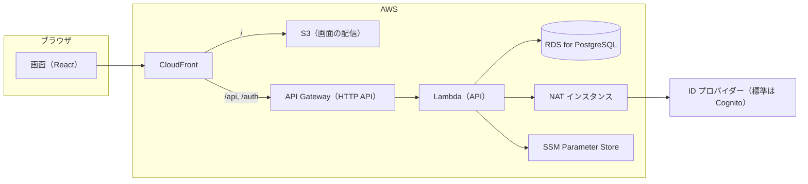
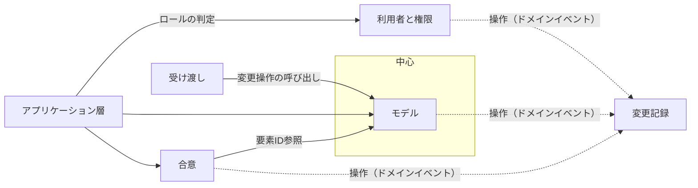

# 設計書: sujigaki（業務設計 SSOT ツール）

| 項目 | 内容 |
|---|---|
| ステータス | Draft |
| 作成日 | 2026-11-19 |
| 要件定義書 | [docs/requirements/business-design-ssot.md](../requirements/business-design-ssot.md) |

## 1. 設計概要

TypeScript のモノレポで、画面・API・ドメインの規則を1つの言語で書く。ドメインの規則（要素の種類、つながりの規則、確認状態の遷移、検証、差分）は I/O を持たないパッケージにまとめ、ブラウザとサーバーの両方で使う。サーバーモードは AWS の Lambda と RDS for PostgreSQL で動かし、ローカルモードは同じサーバーを手元で起動して YAML ファイルを読み書きする。保存先の違いはリポジトリの実装の差し替えで吸収し、ドメインとアプリケーション層は保存先を知らない。

### 1.1 システム構成

- 画面と API は CloudFront で同じオリジンにまとめる。ログインのセッションは暗号化した HttpOnly の Cookie に、利用者の ID と有効期限だけを入れて持つ。ロールはリクエストのたびにデータベースで確かめる。
- ID プロバイダーのクライアントシークレットと、Cookie の暗号化の鍵は、SSM Parameter Store に置く（NFR-007）。
- Lambda は VPC のプライベートサブネットに置く。ID プロバイダーとの通信は NAT インスタンスを経由する（ADR-002）。
- ローカルモードは、`sujigaki` コマンドが手元で API と画面を配信する。データベースと ID プロバイダーは使わない（ADR-003）。
- 開発環境は `docker compose` で、API・画面・PostgreSQL・Keycloak（OIDC プロバイダー）を起動する。AWS アカウントは要らない（NFR-013）。

### 1.2 モジュール構成

| パッケージ | 役割 | 依存してよい先 |
|---|---|---|
| `packages/domain` | モデル・合意・権限の型と規則。I/O を持たない | なし |
| `packages/interchange` | YAML・RDRA 関連データ・AI 向けテキストの変換と、取り込みの差分 | `domain` |
| `apps/server` | API（Hono）。アプリケーション層、保存先の実装（PostgreSQL・ファイル）、OIDC | `domain`, `interchange` |
| `apps/web` | 画面（React、React Flow） | `domain`, `interchange` |
| `apps/cli` | ローカルモードの起動 | `apps/server` |
| `infra` | AWS の環境（AWS CDK） | なし |

依存は表の上から下への一方向とし、`domain` はどこにも依存しない。パッケージをまたぐ循環は、lint の規則で検出する。

### 1.3 主な技術

| 用途 | 技術 |
|---|---|
| 言語 | TypeScript |
| 画面 | React、React Flow（図の描画）、elkjs（自動レイアウト） |
| API | Hono（Lambda と Node.js の両方で動かす） |
| データベース | PostgreSQL、Kysely（SQL の組み立てとマイグレーション） |
| スキーマ | Zod。YAML の形式を公開する JSON Schema も Zod から生成する（FR-050） |
| 認証 | OIDC の認可コードフロー（PKCE 付き）。サーバー側でトークンを交換する |
| IaC | AWS CDK |
| テスト | Vitest、Playwright |

## 2. コンテキストマップ

利用者と権限は、アプリケーション層が操作の前に呼ぶ。モデルと合意は、「誰が、どのロールで操作したか」を値として受け取るだけで、利用者と権限のコンテキストを知らない。

### コンテキスト間の連携一覧

| 発信元 | 宛先 | 経路 | 内容 |
|---|---|---|---|
| 合意 | モデル | 型付き ID | 問い・決定記録・コメントが、対象の要素を `ElementId` で参照する |
| 受け渡し | モデル | 型付き ID と変更操作 | 読み込みや AI の提案から作った変更の一式を、モデルの変更操作として渡す |
| モデル | 変更記録 | ドメインイベント | 要素とつながりの変更、確認状態の変更 |
| 合意 | 変更記録 | ドメインイベント | 問いの状態の変更、決定の記録 |
| 利用者と権限 | 変更記録 | ドメインイベント | 招待、ロールの変更、メンバーの除外 |
| アプリケーション層 | 利用者と権限 | 呼び出し | 操作ごとに、権限の表（FR-081）でロールを判定する |

ドメインイベントは発生した操作と同じトランザクションで操作の記録（`operations` テーブル）に書く。別のプロセスに非同期で渡す処理は、今の要件にはない。

## 3. ドメインモデル

### 要素の種類

要素の種類は次の18種類とする。コードでは RDRA の用語をもとにした識別子を使い、画面では要件定義書 4.1 節の表示名を使う。

| 識別子 | 表示名 | 識別子 | 表示名 |
|---|---|---|---|
| `requirement` | 要求 | `event` | イベント |
| `actor` | 登場人物 | `timer` | 定期処理 |
| `actorGroup` | 登場人物のグループ | `context` | 分類 |
| `externalSystem` | 外部システム | `information` | 情報 |
| `externalSystemGroup` | 外部システムのグループ | `stateModel` | 状態の流れ |
| `business` | 業務 | `state` | 状態 |
| `buc` | 業務フロー | `condition` | 業務ルール |
| `activity` | 活動 | `variation` | 区分 |
| `usecase` | システム操作 | | |
| `screen` | 画面 | | |

項目（属性）は情報の、区分の値はバリエーションの、値オブジェクトとして持つ。関連データでも、この2つは `#attribute` の行として要素の下に置かれるためである。項目や区分の値を変えると、持ち主の情報や区分の内容の編集になる（FR-013）。

### つながりの種類

つながりの種類は、元の要素の種類・先の要素の種類・関連データのタグの組で定義する。定義は [RDRA の関連データ形式の調査](../research/rdra-related-data-format.md) の関係の一覧から、`#attribute`・`#comment`・`#stereotype` の行を除いたものに、次の2つを加える。

- 要求 → 業務（このツール独自の関係）
- 要求 → 登場人物（定義・分析シートの「機能要求」シートの列に合わせる）

定義は `packages/domain` の表として持ち、関連データの読み込み・書き出しと、つながりを作るときの検査の両方で使う。

### 集約一覧

| 集約 | 集約ルート | 含まれるエンティティ/VO | 不変条件 |
|---|---|---|---|
| 要素 | `Element` | 種類ごとの属性（VO）、確認状態（VO）、作成の情報（VO）、外部リンク（エンティティ）、元として持つつながり（エンティティ） | 属性が種類ごとの定義に合う。つながりの種類が元と先の種類の組として定義されている。同じ種類で同じ先へのつながりは1つだけ。内容を編集すると確認状態が未レビューに戻る（FR-013）。確認状態の遷移は要件定義書 7.1 節に従う。削除済みの要素は編集できない |
| 図の配置 | `Layout` | 要素ごとの位置（VO） | 1つの業務フローに1つだけ |
| プロジェクト | `Project` | 設定（VO。システム名、要約の上限） | 要約の上限は1以上 |
| 問い | `Question` | 推奨案（VO）、回答（VO） | 状態の遷移は要件定義書 7.2 節に従う |
| 決定記録 | `Decision` | 関係する要素の ID（VO） | 結論と理由が空でない |
| コメント | `Comment` | なし | 本文が空でない |
| メンバー構成 | `ProjectMembers` | メンバー（エンティティ）、招待（エンティティ）、ロール（VO） | 管理者が1人以上いる。1人の利用者が持つロールは1つ |
| 利用者 | `User` | なし | ID プロバイダーと利用者の識別子の組が一意 |
| 操作 | `Operation` | 変更前と変更後の内容（VO） | 追記だけで、変更も削除もしない |

要素の集約について、次の3つを補足する。

- **つながりは元の要素が持つ**: つながりを追加・削除すると、元の要素のバージョンが上がり、確認状態が未レビューに戻る。FR-013 と FR-070 の要件を、1つの集約の中で守れる（ADR-004）。
- **先の要素を削除してもつながりは残す**: 先の要素が削除済みになったつながりは、表示と検証では切れたものとして扱う。削除と同じトランザクションで、そのつながりの元の要素を未レビューに戻す。復元すると、つながりは元どおりに見える（FR-012）。
- **図の配置は要素に含めない**: 位置を動かしても要素のバージョンは上がらず、確認状態も変わらない。内容の編集と、配置の変更が衝突しない。

`activity` の属性（担当者・開始のきっかけ・入力・手順の概要・例外・終了状態・区分）と、`requirement` の属性（根拠・発生源・優先度・要望の原文）は、種類ごとの属性として持つ（ADR-005）。担当者は登場人物へのつながりで表し、文字列では持たない。

### 未解決の問いの自動作成

FR-035 の問いは検証（FR-040）と同じく、モデルから毎回計算して確認ボードに出す。保存はしない。利用者が回答したときに、問いの集約として保存する。空欄が埋まれば、計算した問いは消える。

### ドメインイベント

| イベント名（過去形） | 発生タイミング | 購読者 |
|---|---|---|
| `ElementCreated` | 要素を作成した | 変更記録 |
| `ElementEdited` | 名前・要約・属性・外部リンクを変えた | 変更記録 |
| `RelationAdded` / `RelationRemoved` | つながりを追加・削除した | 変更記録 |
| `ReviewStateChanged` | 確認状態が変わった（自動で未レビューに戻った場合を含む） | 変更記録 |
| `ElementDeleted` | 要素を論理削除した | モデル（切れたつながりの元の要素を未レビューに戻す）、変更記録 |
| `ElementRestored` / `ElementPurged` | 要素を復元した／完全に削除した | 変更記録 |
| `LayoutChanged` | 図の配置を保存した | 変更記録 |
| `QuestionAsked` / `QuestionAnswered` / `QuestionResolved` / `QuestionWithdrawn` | 問いを作成した、回答した、解決した、取り下げた | 変更記録 |
| `DecisionRecorded` | 決定を記録した | 変更記録 |
| `MemberInvited` / `MemberRoleChanged` / `MemberRemoved` | 招待した、ロールを変えた、除外した | 変更記録 |
