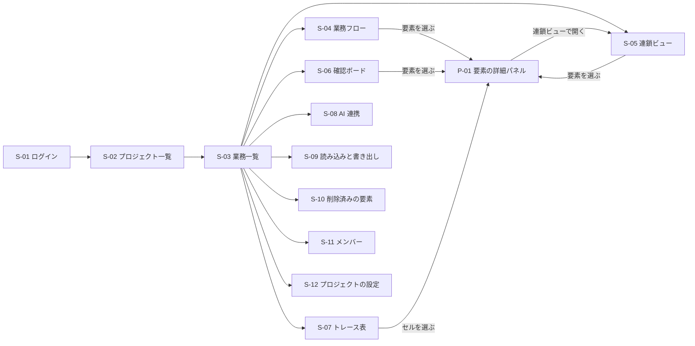

# 画面設計書: sujigaki（業務設計 SSOT ツール）

| 項目 | 内容 |
|---|---|
| ステータス | Draft |
| 作成日 | 2026-11-19 |
| 要件定義書 | [docs/requirements/business-design-ssot.md](../requirements/business-design-ssot.md) |
| 設計書 | [docs/design/business-design-ssot.md](business-design-ssot.md) |

## 1. 方針

- 画面には RDRA の用語を出さず、要件定義書 4.1 節の表示名を使う（NFR-016）。
- 図は選んだ業務フローや要素を起点に、範囲を絞って描く。プロジェクト全体を一度に描かない（FR-021、NFR-002）。
- 確認状態と区分は、色に加えて、アイコンと文字でも区別する（NFR-017）。区別のしかたは5章にまとめる。
- 対象は PC のブラウザとする。幅 1280px 以上で3列の構成を基本とし、それより狭いときは右の詳細パネルを中央の上に重ねて開く。
- 操作できないボタンは隠さず、押せない状態で表示し、理由（「業務責任者以上が操作できます」など）を添える。ロールで出し分けると、何ができないのかが利用者にわからないためである。ただし、管理者向けの画面（メンバー、設定）は、管理者にだけ左のナビゲーションに表示する。

## 2. 画面の一覧

| ID | 画面 | 主な要件 | 主に使う人 |
|---|---|---|---|
| S-01 | ログイン | FR-080 | 全員（サーバーモードだけ） |
| S-02 | プロジェクト一覧 | FR-060, FR-090 | 全員（サーバーモードだけ） |
| S-03 | 業務一覧 | FR-010 | 全員 |
| S-04 | 業務フロー | FR-002, FR-010, FR-020, FR-023 | 業務部門の担当者、編集者 |
| S-05 | 連鎖ビュー | FR-021, FR-022, FR-023 | PM・BA、エンジニア |
| S-06 | 確認ボード | FR-024, FR-030, FR-031, FR-035, FR-040 | 業務責任者、編集者 |
| S-07 | トレース表 | FR-025 | PM・BA、エンジニア |
| S-08 | AI 連携 | FR-033, FR-034 | 編集者 |
| S-09 | 読み込みと書き出し | FR-050, FR-051, FR-052 | 編集者、業務責任者 |
| S-10 | 削除済みの要素 | FR-012 | 編集者、管理者 |
| S-11 | メンバー | FR-082 | 管理者 |
| S-12 | プロジェクトの設定 | FR-005 | 管理者 |
| P-01 | 要素の詳細パネル | FR-002〜004, FR-010, FR-012, FR-013, FR-030〜032, FR-072, US-009 | 全員 |
| D-01 | 衝突のダイアログ | FR-070 | 編集者 |
| D-02 | 削除の確認のダイアログ | FR-012 | 編集者 |

検索（FR-026）と、ほかの人の更新の通知（FR-071）は、すべての画面のヘッダーに置く。

## 3. 画面の遷移



ローカルモードでは S-01 と S-02 を出さず、S-03 から始める。左のナビゲーションから、S-03 以降のどの画面にも直接移れる。

## 4. 共通の画面構成

```text
┌────────────────────────────────────────────────────────────────┐
│ プロジェクト名 ▾   [ 要素を検索… ]        ⟳ 3件の更新  利用者名 ▾ │
├──────────────┬──────────────────────────────┬──────────────────┤
│ 業務           │                              │ 要素の詳細パネル    │
│  ▸ 申込受付     │   中央: 選んだ画面             │ （P-01）           │
│     業務フロー   │   （業務フロー、連鎖ビュー、    │                    │
│  ▸ 請求         │     確認ボード、トレース表など） │ 要素を選んだときに   │
│ ─────────     │                              │ 開く               │
│ 確認ボード      │                              │                    │
│ トレース表      │                              │                    │
│ AI 連携         │                              │                    │
│ 読み込みと書き出し│                              │                    │
│ 削除済みの要素   │                              │                    │
│ ─────────     │                              │                    │
│ メンバー（管理者）│                              │                    │
│ 設定（管理者）   │                              │                    │
└──────────────┴──────────────────────────────┴──────────────────┘
```

- **ヘッダー**: プロジェクトの切り替え、検索、更新の通知、利用者のメニュー（ログアウト）を置く。
- **検索（FR-026）**: 名前と要約で探し、候補を種類の表示名と一緒に出す。選ぶと、その要素の詳細パネルを開く。該当がないときは「『返金』に当てはまる要素はありません」と出す。候補は名前に当てはまる要素を先に、最大10件まで出し、削除済みの要素は出さない。業務一覧のように詳細パネルを出さない画面では、選んだ要素を起点に連鎖ビュー（S-05）を開き、詳細パネルも開く。
- **更新の通知（FR-071）**: ほかの人の更新があると、ヘッダーに件数と「再読み込み」のボタンを出す。編集中で未保存の内容があるときは、再読み込みの前に保存するか捨てるかを聞く。タブが表示されているあいだ30秒ごとと、タブに戻ったときに確かめる。自分の操作は数えない。ローカルモードでは、ファイルが外で変わったこと（エディターでの編集や `git pull`）を1件の更新として数える。
- **左のナビゲーション**: 業務の木（業務の下に業務フロー）と、プロジェクト全体の画面へのリンクを置く。

## 5. 表現の規則（NFR-017）

色だけに頼らず、アイコンと文字を必ず一緒に出す。

| 対象 | 値 | アイコン | 文字 | 色 |
|---|---|---|---|---|
| 確認状態 | 未レビュー | ○（中が空の丸） | 未レビュー | 灰 |
| | 要確認 | ？（丸の中に疑問符） | 要確認 | 黄 |
| | 要修正 | ！（三角の中に感嘆符） | 要修正 | 赤 |
| | 確認済み | ✓（丸の中にチェック） | 確認済み | 緑 |
| 区分（活動） | 手作業 | 手のアイコン。枠は破線の角丸 | 手作業 | 橙 |
| | システム利用 | 画面のアイコン。枠は実線の四角 | システム | 青 |
| 作成者の種類 | AI | 「AI」のタグ | AI | 紫 |
| | 読み込み | 「読み込み」のタグ | 読み込み | 灰 |
| 検証の違反 | | 三角の注意のアイコン | 違反の内容（「担当者が未設定」など） | 黄 |

- 図の上では、場所を取らないように確認状態はアイコンだけにし、文字はマウスを重ねたときと読み上げで出す。一覧と詳細パネルでは、アイコンと文字を並べて出す。
- 要素の種類は種類ごとのアイコンと表示名で示す。

## 6. 各画面

### S-01 ログイン

「ログイン」のボタンだけを置き、押すと ID プロバイダーの画面に移る。招待されていない利用者がログインしたときは、「参加しているプロジェクトがありません。管理者に招待を依頼してください」と出す。

### S-02 プロジェクト一覧

参加しているプロジェクトを、名前・自分のロール・最終更新日時の一覧で出す。プロジェクトを作れる利用者には「新しいプロジェクト」のボタンを出す（FR-090）。

### S-03 業務一覧

プロジェクトを開いたときの最初の画面。業務ごとに、その下の業務フローと、確認状態ごとの要素の数を出す。業務と業務フローの追加はこの画面で行う。

### S-04 業務フロー

```text
┌─ 業務フロー: 研修の受講申込 ───────────── 表示: [業務の流れ ▾] ─┐
│ 受講者   │ ┌──────────────┐                                   │
│          │ │🖥 研修に申し込む ○│──┐                                │
│          │ └──────────────┘  │                                │
│──────────│───────────────────│────────────────────────────────│
│ 上長     │                   └─▶┌──────────────┐               │
│          │                      │🖥 申込を承認する ✓│──┐            │
│          │                      └──────────────┘  │            │
│──────────│──────────────────────────────────────│────────────│
│ 研修担当 │                                       └─▶ ┌┄┄┄┄┄┄┄┄┄┄┐ │
│          │                                          ┆✋ 受講案内を ┆ │
│          │                                          ┆ 送る  ⚠    ┆ │
│          │                                          └┄┄┄┄┄┄┄┄┄┄┘ │
│──────────│──────────────────────────────────────────────────│
│ 担当者が │  ＋ 活動を追加                                       │
│ 未設定   │                                                   │
└──────────┴───────────────────────────────────────────────────┘
```

- 担当者（登場人物）ごとに横のレーンを作り、活動を左から右へ流れの順に並べる（FR-020）。担当者が未設定の活動は、いちばん下の「担当者が未設定」のレーンに置く。
- 活動のカードには名前・区分・確認状態を出し、つながっているシステム操作の名前を小さく添える。非表示の種類の要素がつながっているときは、「情報 2」のようなバッジを出す（FR-023）。
- 活動がない業務フローは、空のレーンと「活動を追加してください」の案内を出す。
- 編集者以上は、次の操作ができる。
  - 「＋ 活動を追加」で活動を作る。入力欄の近くに、活動を分ける3つの目安を出す（FR-002）。
  - カードの名前をダブルクリックして、その場で直す（US-001）。
  - カードの端から別のカードへドラッグして、流れの順をつなぐ。
  - カードをドラッグして位置を動かす。位置は図の配置として保存し、確認状態は変えない（FR-013）。
- 初めて開いたときや、新しい活動を足したときの位置は、自動で並べる。

### S-05 連鎖ビュー

```text
┌─ 起点: 画面「申込入力」  前後 [2 ▾] 段   表示: [業務の流れ ▾] [種類 ▾] ─┐
│                                                                   │
│  要求          業務        活動            システム操作     画面        │
│ ┌────────┐  ┌──────┐  ┌──────────┐  ┌──────────┐  ┏━━━━━━┓     │
│ │申込を当日 │━━│申込受付│━━│研修に申し込む│━━│研修に申し込む│━━┃申込入力┃     │
│ │中に処理  │  └──────┘  └──────────┘  └──────────┘  ┗━━━━━━┛     │
│ └────────┘                                                        │
└───────────────────────────────────────────────────────────────────┘
```

- 起点に選んだ要素から、前後に指定した段数（既定は2段、1〜4段）までのつながりを描く（FR-021）。
- 要素は種類ごとの列に並べ、左から要求・業務・業務フロー・活動・システム操作・画面と情報、の順にする。登場人物・状態・業務ルールなどは表示したときに右側の列に出す。
- 要素を選ぶと、その要素から要求までの経路と、画面・情報までの経路を太線で強調する。
- 描く要素が200件を超えるときは、起点に近い順に200件まで描き、「ほかに N 件あります。段数を減らすか、表示する種類を絞ってください」と出す（NFR-002）。
- 起点がどこにもつながっていないときは、起点だけを描き、「つながっている要素はありません」と出す。
- 表示の切り替え（FR-022）は7章のプリセットと、種類ごとのチェックで行う。

### S-06 確認ボード

```text
┌─ 確認ボード   絞り込み: [自分が確認するもの ▾]  業務: [すべて ▾] ───┐
│ ■ 申込受付                                                      │
│   要確認 (3)        未回答の問い (2)       検証の違反 (1)           │
│   ？ 申込を承認する   ・担当者は誰ですか      ⚠ 受講案内を送る:      │
│   ？ 申込入力        （推奨: 研修担当）        担当者が未設定        │
│   ？ 申込           ・締め切りはいつですか                         │
│ ■ 請求                                                          │
│   …                                                             │
└─────────────────────────────────────────────────────────────────┘
```

- 業務ごとにまとめ、要素を確認状態ごとに、問いと検証の違反と並べて出す（FR-024）。
- 絞り込みの既定はロールで変える。業務責任者以上は「自分が確認するもの」（要確認の要素と未回答の問い）、編集者は「直すもの」（要修正の要素と検証の違反）とする。
- 空欄から作った問い（FR-035）は、ほかの問いと同じ一覧に「自動」のタグを付けて出す。
- 問いには推奨案を採用するボタンと、回答を書く欄を置く（FR-031）。閲覧者も回答できる。
- 要素を選ぶと詳細パネルを開き、そこで確認状態を変える（FR-030）。

### S-07 トレース表

- 1行を、要求からシステム操作までの1本の経路とし、列は要求・業務・業務フロー・活動・システム操作・画面・情報とする（FR-025）。画面と情報は、そのシステム操作につながるものを1つのセルにまとめる。組み合わせの数だけ行を増やさないためである。
- つながりが途切れているセルは、背景の色と模様に加えて「なし」と文字で出す。手作業の活動は、システム操作がなくても途切れとは扱わない。
- 列ごとに並べ替えができ、文字と「途切れている行だけ」で絞り込める。セルを選ぶと、その要素の詳細パネルを開く。

### S-08 AI 連携

「AI に渡す」と「提案を取り込む」の2つのタブに分ける。

**AI に渡す（FR-033）**

1. 範囲（業務、業務フロー、選んでいる要素）と、用途のテンプレート（下書きの作成、抜け漏れの指摘、質問の作成）を選ぶ。
2. 作ったテキストを下に出し、「コピー」のボタンでクリップボードに入れる。文字数と、目安のトークン数も出す。

**提案を取り込む（FR-034）**

1. AI の返答を貼り付ける欄に入れ、「差分を見る」を押す。
2. 形式の誤りと検証の違反があれば、一覧の上にまとめて出す。形式の誤りがある提案は採用できない。
3. 差分を「追加」「変更」「削除」に分けて出す。変更は項目ごとに今の内容と提案を並べる。
4. 要素ごとにチェックを付けて採否を決め、「採用した変更を反映」を押す。反映した要素は未レビューになり、「AI」のタグが付く。
5. 反映の前にほかの人が同じ要素を更新していたときは、反映せずに、その要素を一覧で示す。

### S-09 読み込みと書き出し

- **範囲**: 画面の上で、全体か業務かを選ぶ。YAML と関連データの書き出し、関連データの読み込みに使う。YAML の読み込みではファイルに書いた範囲を使い、範囲のあるファイルならそのことを出す。
- **書き出し**: 形式（このツールの YAML、RDRA の関連データ）と範囲（全体、業務）を選ぶ。関連データのときは、要求とこのツール独自の属性が含まれないことと、名前が重なる要素の一覧を、書き出しの前に出す（FR-051）。
- **YAML の読み込み**: 空のプロジェクトでは「復元」、要素があるプロジェクトでは「取り込み」として扱う（FR-050）。復元のときは、自分のロールで確認状態が保たれるかどうかを、実行の前に出す。取り込みは S-08 と同じ差分の画面を使う。
- **関連データの読み込み（FR-052）**: S-08 と同じ差分の画面を使う。その前に、名前の変更が疑われる要素の対応づけを確かめる段階を入れる。消えた要素と新しい要素を左右に並べ、「同じ要素」として対応づけるか、別の要素として扱うかを選ぶ。

### S-10 削除済みの要素

削除済みの要素を、種類・名前・削除した日時・削除した人の一覧で出し、復元のボタンを置く（FR-012）。管理者には「完全に削除」のボタンも出し、元に戻せないことを確認のダイアログで伝える。

新しく削除したものを上に並べる。ローカルモードには利用者がいないため、削除した人の列を出さない。復元すると、削除する前のつながりも元に戻る。

### S-11 メンバー

メンバーと未受諾の招待を一覧で出す。招待（メールアドレスとロール）、ロールの変更、除外ができる（FR-082）。最後の管理者は除外もロールの変更もできず、その理由を出す。

### S-12 プロジェクトの設定

プロジェクトの名前、関連データに書き出すシステム名、要約の文字数の上限（FR-005）を変える。

変えた項目があるときだけ保存のボタンを押せる。要約の上限を下げても、上限を超えた要約はそのまま残り、検証の違反として出る。左のナビゲーションには設定を変えられる管理者にだけ出す。

### P-01 要素の詳細パネル

要素を選ぶと右に開く。上から次の順に並べる。

1. **見出し**: 種類の表示名、名前、確認状態、作成者の種類のタグ
2. **確認状態**: 自分のロールで遷移できる状態だけを、ボタンで出す（FR-030）
3. **内容**: 要約（上限の文字数と、今の文字数を出す）、種類ごとの属性
4. **つながり**: つながっている要素を種類ごとに出す。「＋ つなぐ」で、つなげる種類の要素だけを候補として探す（FR-001、FR-010）
5. **外部リンク**: 種類・リンクの名前・URL（FR-004）
6. **問いと決定記録**: この要素の問いと、結び付いた決定記録（FR-031、FR-032）
7. **コメント**（US-009）
8. **変更履歴**: 誰が・いつ・何を変えたか（FR-072）。ローカルモードでは出さない

確認済み・要確認・要修正の要素の内容を編集し始めると、保存のボタンの近くに「保存すると未レビューに戻ります」と出す（FR-013）。外部リンク・問い・コメントはこの表示を出さずに保存できる。

「連鎖ビューで開く」のボタンで、この要素を起点に S-05 を開く。

一番下に「削除」のボタンを置く（FR-012）。押すと D-02 を開く。削除したらパネルを閉じる。

### D-01 衝突のダイアログ

保存したときに、ほかの人が先に同じ要素を更新していたら開く（FR-070）。

- 左に自分の変更、右に今の内容を並べ、違う項目を強調する。
- 「自分の内容で上書き」と「今の内容を使う（自分の変更を捨てる）」から選ぶ。
- 選ぶ前に、自分の変更をクリップボードにコピーできる。

### D-02 削除の確認のダイアログ

要素を削除する前に開く（FR-012）。この要素とつながっている要素を、種類の表示名と名前で一覧にし、削除するとつながりが表示から消えることを伝える。つながっている要素がなければ、その旨を出す。「削除する」と「やめる」から選ぶ。

## 7. 表示の設定（FR-022）

| プリセット | 表示する種類 |
|---|---|
| 業務の流れ（既定） | 要求・業務・活動・システム操作 |
| 画面と情報 | システム操作・画面・イベント・情報 |
| すべて | すべての種類 |

- プリセットを選んだあとに、種類ごとのチェックで足し引きできる。
- 選んだ表示の設定は利用者とプロジェクトの組ごとにサーバーに保存し、別の PC やログインし直したあとも同じ状態で開く。ローカルモードではブラウザに保存する。

## 8. 要件との対応

| 要件ID | 対応する画面 |
|---|---|
| FR-002 | S-04（活動を分ける目安）、P-01 |
| FR-003 | P-01（見出し、変更履歴） |
| FR-004 | P-01（外部リンク） |
| FR-005 | P-01（文字数）、S-12 |
| FR-010 | S-03、S-04、P-01 |
| FR-012 | P-01、D-02、S-10 |
| FR-013 | S-04（配置の変更）、P-01（未レビューに戻る表示） |
| FR-020 | S-04 |
| FR-021 | S-05 |
| FR-022 | S-04、S-05、7章 |
| FR-023 | S-04、S-05（バッジ） |
| FR-024 | S-06 |
| FR-025 | S-07 |
| FR-026 | 4章（ヘッダーの検索） |
| FR-030 | S-06、P-01 |
| FR-031 | S-06、P-01 |
| FR-032 | P-01 |
| FR-033 | S-08 |
| FR-034 | S-08 |
| FR-035 | S-06（「自動」のタグ） |
| FR-040 | S-06、5章 |
| FR-050〜052 | S-09 |
| FR-060 | S-02 |
| FR-070 | D-01 |
| FR-071 | 4章（ヘッダーの通知） |
| FR-072 | P-01（変更履歴） |
| FR-080 | S-01 |
| FR-081 | 1章（押せないボタンの表示）、P-01 |
| FR-082 | S-11 |
| FR-090 | S-02 |
| NFR-002 | S-05（200件の上限） |
| NFR-016 | 1章 |
| NFR-017 | 5章 |

## 9. 未解決事項

| # | 論点 | 担当 | 期限 |
|---|---|---|---|
| 1 | 業務フローの自動レイアウトが、活動が多い業務フローでも読める形になるか | 開発 | プロトタイプの後 |
| 2 | 業務部門の担当者が、説明なしで業務フローを読めるか（NFR-016 の利用者テスト） | 開発 | プロトタイプの後 |

## 10. 変更履歴

| 日付 | 変更内容 | 変更者 |
|---|---|---|
| 2026-11-19 | 初版を作成 | 開発 |
| 2026-11-20 | S-07 の行の作り方と絞り込みを、実装に合わせて直した | 開発 |
| 2026-11-20 | P-01 に削除のボタンを、D-02 に削除の確認を加え、S-10 の並び順を決めた | 開発 |
| 2026-11-20 | S-12 の保存のボタンと、上限を下げたときの扱いを決めた | 開発 |
| 2026-11-20 | 検索の候補の並びと件数、詳細パネルを出さない画面での動きを決めた | 開発 |
| 2026-11-20 | 更新の通知を確かめる時機と、数える操作を決めた | 開発 |
| 2026-11-20 | S-09 の範囲の選び方を決めた | 開発 |
