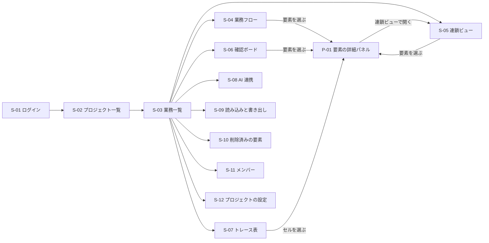

# 画面設計書: sujigaki（業務設計 SSOT ツール）

| 項目 | 内容 |
|---|---|
| ステータス | Draft |
| 作成日 | 2026-11-19 |
| 要件定義書 | [docs/requirements/business-design-ssot.md](../requirements/business-design-ssot.md) |
| 設計書 | [docs/design/business-design-ssot.md](business-design-ssot.md) |

## 1. 方針

- 画面には RDRA の用語を出さず、要件定義書 4.1 節の表示名を使う（NFR-016）。
- 図は選んだ業務フローや要素を起点に、範囲を絞って描く。プロジェクト全体を一度に描かない（FR-021、NFR-002）。
- 確認状態と区分は、色に加えて、アイコンと文字でも区別する（NFR-017）。区別のしかたは5章にまとめる。
- 対象は PC のブラウザとする。幅 1280px 以上で3列の構成を基本とし、それより狭いときは右の詳細パネルを中央の上に重ねて開く。
- 操作できないボタンは隠さず、押せない状態で表示し、理由（「業務責任者以上が操作できます」など）を添える。ロールで出し分けると、何ができないのかが利用者にわからないためである。ただし、管理者向けの画面（メンバー、設定）は、管理者にだけ左のナビゲーションに表示する。

## 2. 画面の一覧

| ID | 画面 | 主な要件 | 主に使う人 |
|---|---|---|---|
| S-01 | ログイン | FR-080 | 全員（サーバーモードだけ） |
| S-02 | プロジェクト一覧 | FR-060, FR-090 | 全員（サーバーモードだけ） |
| S-03 | 業務一覧 | FR-010 | 全員 |
| S-04 | 業務フロー | FR-002, FR-010, FR-020, FR-023 | 業務部門の担当者、編集者 |
| S-05 | 連鎖ビュー | FR-021, FR-022, FR-023 | PM・BA、エンジニア |
| S-06 | 確認ボード | FR-024, FR-030, FR-031, FR-035, FR-040 | 業務責任者、編集者 |
| S-07 | トレース表 | FR-025 | PM・BA、エンジニア |
| S-08 | AI 連携 | FR-033, FR-034 | 編集者 |
| S-09 | 読み込みと書き出し | FR-050, FR-051, FR-052 | 編集者、業務責任者 |
| S-10 | 削除済みの要素 | FR-012 | 編集者、管理者 |
| S-11 | メンバー | FR-082 | 管理者 |
| S-12 | プロジェクトの設定 | FR-005 | 管理者 |
| P-01 | 要素の詳細パネル | FR-002〜004, FR-010, FR-013, FR-030〜032, FR-072, US-009 | 全員 |
| D-01 | 衝突のダイアログ | FR-070 | 編集者 |

検索（FR-026）と、ほかの人の更新の通知（FR-071）は、すべての画面のヘッダーに置く。

## 3. 画面の遷移



ローカルモードでは S-01 と S-02 を出さず、S-03 から始める。左のナビゲーションから、S-03 以降のどの画面にも直接移れる。

## 4. 共通の画面構成

```text
┌────────────────────────────────────────────────────────────────┐
│ プロジェクト名 ▾   [ 要素を検索… ]        ⟳ 3件の更新  利用者名 ▾ │
├──────────────┬──────────────────────────────┬──────────────────┤
│ 業務           │                              │ 要素の詳細パネル    │
│  ▸ 申込受付     │   中央: 選んだ画面             │ （P-01）           │
│     業務フロー   │   （業務フロー、連鎖ビュー、    │                    │
│  ▸ 請求         │     確認ボード、トレース表など） │ 要素を選んだときに   │
│ ─────────     │                              │ 開く               │
│ 確認ボード      │                              │                    │
│ トレース表      │                              │                    │
│ AI 連携         │                              │                    │
│ 読み込みと書き出し│                              │                    │
│ 削除済みの要素   │                              │                    │
│ ─────────     │                              │                    │
│ メンバー（管理者）│                              │                    │
│ 設定（管理者）   │                              │                    │
└──────────────┴──────────────────────────────┴──────────────────┘
```

- **ヘッダー**: プロジェクトの切り替え、検索、更新の通知、利用者のメニュー（ログアウト）を置く。
- **検索（FR-026）**: 名前と要約で探し、候補を種類の表示名と一緒に出す。選ぶと、その要素の詳細パネルを開く。該当がないときは「『返金』に当てはまる要素はありません」と出す。
- **更新の通知（FR-071）**: ほかの人の更新があると、ヘッダーに件数と「再読み込み」のボタンを出す。編集中で未保存の内容があるときは、再読み込みの前に保存するか捨てるかを聞く。
- **左のナビゲーション**: 業務の木（業務の下に業務フロー）と、プロジェクト全体の画面へのリンクを置く。
