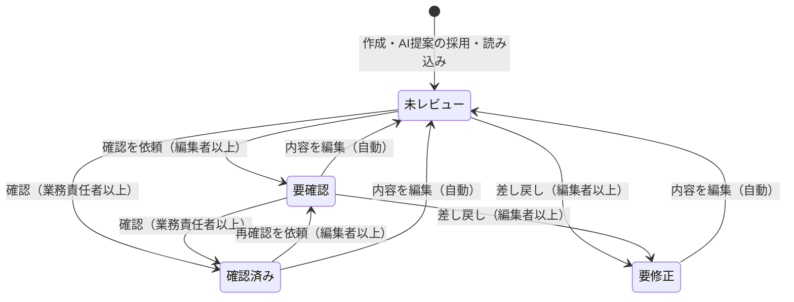
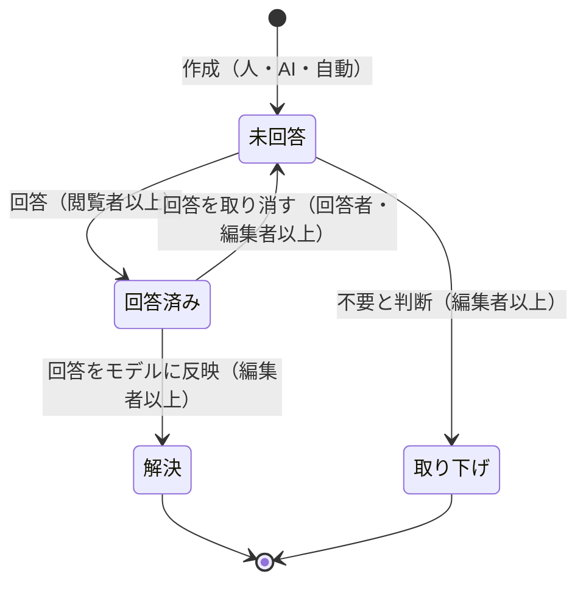
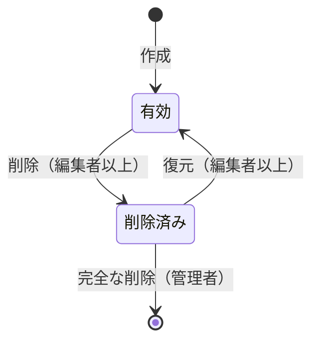

# 要件定義書: sujigaki（業務設計 SSOT ツール）

| 項目 | 内容 |
|---|---|
| ステータス | Draft |
| 作成日 | 2026-11-19 |
| 最終更新 | 2026-11-19 |
| 関連ドキュメント | 設計書（未作成）: `docs/design/business-design-ssot.md` |

## 1. 背景と課題（Why）

### 1.1 課題

利用者のユースケースに沿わないシステムは、運用の手間を重くし、最終的に利用者の満足度を下げる。主な原因は次の3つである。

1. **業務とシステムのつながりが見えない**: 業務設計・業務手順と、システムの画面・情報とのつながりが見えないまま開発が進む。その結果、業務に合わない画面や、システムの外に残る手作業が生まれる。
2. **文書が多すぎて全体を見渡せない**: 生成 AI に要求定義や要件定義を書かせると、文章の量が多くなりすぎる。人が全体を見渡して確認するのが難しい。
3. **確認と合意の記録が残らない**: AI が書いた内容と、人が確認・合意した内容の区別がつかない。何が決まっていて何が未決なのかがわからない。

### 1.2 解決の方針

要求から画面・情報までのつながりを、[RDRA](https://www.rdra.jp/) に準拠したモデルとして1か所に持ち、業務設計の SSOT（Single Source of Truth）として運用する。モデルは短い要素とつながりで表し、図で見ながら画面上で編集できるようにする。AI はツールに組み込まず、AI が下書きや質問をし、人が判断して取り込む流れを支える。

### 1.3 参考にした資料と、このツールの位置づけ

| 資料 | 取り入れる考え方 |
|---|---|
| IPA「AI 時代の要求管理ハンドブック」 | 要望・要求・要件の区別。要求の根拠・発生源・優先度。AI の出力は候補として扱い、判断は人が行う。小さく始める |
| [RDRA ツール群](https://www.rdra.jp/rdra%E3%83%84%E3%83%BC%E3%83%AB) | AI が作り、人が直し、図で確かめる分担。関連データ形式での受け渡し。表示する要素の切り替え |
| [alder](https://github.com/mk3008/alder) | 業務判断は人が持つ。確認状態（未レビュー／要確認／確認済み／要修正）。構造が正しくても合意の証拠にはしない。未決事項を見える形で残す。活動の粒度の決め方 |
| [untie](https://github.com/tango238/untie) | 現場の言葉で見せ、RDRA の用語を画面に出さない。AI はモデルにある事実を聞かず、推奨案を付けて質問する。担当者が書いた原文を残す |

RDRA のツール群では、編集（スプレッドシート）と閲覧（RDRAGraph）が別のツールに分かれている。untie は手段を決める前の課題の特定を出口にしている。このツールは To-Be の業務から画面・情報までを、確認状態とともに継続して運用する部分を受け持つ。

## 2. ゴールと成功指標

| ゴール | 成功指標 |
|---|---|
| G1. 要求から画面・情報までのつながりを1か所で見渡し、編集できる | 任意の画面から、関連する要求まで3回以内の操作でたどれる |
| G2. ビジネス側の人が、専門用語を知らなくても確認と承認に参加できる | 既定の表示に RDRA の専門用語が出ない。業務責任者が、ツール上の操作だけで確認状態を付けられる |
| G3. AI の下書きや質問を、人の判断を経て取り込める | AI の出力が、人の採用を経ずに正式な内容（確認済み）にならない |
| G4. つながりの抜け漏れを機械的に見つけられる | 検証ルール（FR-040）に違反する要素を、一覧として表示できる |

指標の具体的な目標値（G1 の操作回数を含む）は、プロトタイプでの検証後に見直す（未解決事項 #6）。

## 3. ユーザーストーリー

| ID | 誰が | 何のために | 何をする |
|---|---|---|---|
| US-001 | 業務部門の担当者 | 自分の業務が正しく表されているかを確かめるため | シンプルな表示で業務フローを見て、名前や担当者をその場で直す |
| US-002 | 業務責任者 | 業務の決定に責任を持つため | 要素を「確認済み」にし、未解決の問いに答え、重要な決定を記録する |
| US-003 | PM・BA | 要求から画面までの抜け漏れをなくすため | 要素をつなぎ、検証で見つかった途切れを解消する |
| US-004 | エンジニア | 実装の根拠を確かめるため | 画面・情報から、元の業務と要求へ逆にたどる |
| US-005 | 編集者 | AI に下書きや質問をさせるため | 選んだ範囲を AI に渡し、返ってきた提案を差分で見て、要素ごとに採否を決める |
| US-006 | RDRA の利用者 | 既存の RDRA の資産を活かすため | RDRA の関連データ形式で、モデルを読み込み・書き出す |
| US-007 | 個人の利用者 | サーバーを用意せずに使うため | 手元のファイルに保存し、Git で管理する |
| US-008 | 管理者 | 適切な人に適切な権限を与えるため | メンバーを招待し、ロールを割り当てる |
| US-009 | 閲覧者 | 編集権限がなくても、ヒアリングに参加するため | 未解決の問いに回答し、コメントを書く |

## 4. 前提条件

- 要素の種類・定義・粒度は RDRA 2.0 の公式資料に従う。このツール独自の情報は新しい層を作らず、既存の要素の属性として追加する。
- サーバーで利用する場合は、AWS にデプロイする。
- 1つのプロジェクトには、SaaS 1つ分の業務運用がすべて載ることを想定する。要素数は数千件から1万件程度とする。
- 同時に編集する人数は5〜10人を想定する。業務設計は頻繁に書き換えるものではなく、編集の頻度は低い。
- 利用形態は自社やチームでの利用とする。ソースコードは公開リポジトリで公開するが、複数の組織向けの SaaS としては提供しない。
- AI はツールに組み込まない。利用者が自分で Claude や ChatGPT などを使う。
- ローカルモードは1人で使うことを前提とする。
- 利用環境は PC のブラウザ（Chrome・Edge・Safari・Firefox の最新版）とする（仮定）。
- 画面の言語は日本語とする。

### 4.1 用語

画面では RDRA の用語の代わりに次の表示名を使う。対応表は設計で確定する（未解決事項 #2）。

| 表示名（画面） | RDRA の要素 |
|---|---|
| 要求 | 要求 |
| 業務 | 業務 |
| 業務のまとまり | ビジネスユースケース（BUC） |
| 活動 | アクティビティ |
| 使い方 | ユースケース |
| 画面 | 画面・帳票 |
| 情報 | 情報 |
| 状態・条件・イベントなど | 状態・条件・バリエーション・イベントなど |

## 5. 機能要件

### 5.1 モデル

#### FR-001: RDRA の要素と関係を保持する

- **概要**: RDRA 2.0 の全要素と、要素間の関係を保持する。画面で編集できない要素も、データとしては保持する。
- **関連ストーリー**: US-003, US-006
- **優先度**: Must

**受け入れ条件**:

```gherkin
Scenario: 全種類の要素を保持できる
  Given RDRA 2.0 の全種類の要素を含むモデルがある
  When モデルを保存して読み込み直す
  Then 全要素と全関係が、保存前と同じ内容で復元される

Scenario: 定義されていない関係を拒否する
  Given 「画面」と「要求」を直接つなぐ関係は RDRA で定義されていない
  When その関係を作ろうとする
  Then 関係は作られず、作れない理由が表示される
```

#### FR-002: 活動に業務手順の属性を持たせる

- **概要**: 活動（アクティビティ）に、担当者・開始のきっかけ・入力・手順の概要・例外・終了状態・区分（手作業／システム利用）を持たせる。
- **関連ストーリー**: US-001, US-003
- **優先度**: Must

**受け入れ条件**:

```gherkin
Scenario: 業務手順の属性を記録する
  Given 活動「申込内容を確認する」がある
  When 担当者「審査担当」、区分「手作業」、例外「必須項目の不足」を入力して保存する
  Then 業務フローと連鎖ビューで、その担当者と区分が表示される

Scenario: 担当者を指定せずに保存する
  Given 活動「申込内容を確認する」がある
  When 担当者を空のまま保存する
  Then 保存はできる
  And 検証結果に「担当者が未設定」として表示される
```

#### FR-003: 全要素に共通の管理情報を持たせる

- **概要**: 全要素に、確認状態・作成者の種類（人／AI／読み込み）・出所・作成日時・更新日時・更新者を持たせる。要求にはさらに根拠・発生源・優先度・要望の原文を持たせる。
- **関連ストーリー**: US-002, US-005
- **優先度**: Must

**受け入れ条件**:

```gherkin
Scenario: AI 提案から作られた要素の出所がわかる
  Given AI の提案を採用して作られた要素がある
  When その要素の詳細を開く
  Then 作成者の種類に「AI」、出所に取り込みの日時が表示される

Scenario: 要望の原文を残す
  Given 業務部門の担当者が書いた要望の原文がある
  When その原文をもとに要求を作る
  Then 要求の詳細で、原文と整理後の要求文を並べて見られる
```

#### FR-004: 外部リンクを付ける

- **概要**: どの要素にも種類（マニュアル・詳細仕様・デザイン・チケット・その他）と URL を持つ外部リンクを、複数付けられる。リンク先の内容は管理しない。
- **関連ストーリー**: US-001, US-004
- **優先度**: Must

**受け入れ条件**:

```gherkin
Scenario: マニュアルへのリンクを付ける
  Given 活動「請求書を発行する」がある
  When 種類「マニュアル」と URL を入力して保存する
  Then 活動の詳細からリンクを開ける

Scenario: URL の形式が正しくない
  Given 活動「請求書を発行する」がある
  When http または https で始まらない文字列を URL に入力して保存する
  Then 保存されず、URL の形式が正しくないことが表示される
```

#### FR-005: 要約の長さに上限を設ける

- **概要**: 要素の要約に文字数の上限を設ける。上限を超える説明は外部リンクに移すよう促す。上限の値はプロジェクトごとに設定でき、既定値は設計で決める。
- **関連ストーリー**: US-001, US-005
- **優先度**: Should

**受け入れ条件**:

```gherkin
Scenario: 上限を超える要約
  Given 要約の上限がプロジェクトで設定されている
  When 上限を超える要約を入力する
  Then 保存はできる
  And 検証結果に「要約が長すぎる」として表示される
```

### 5.2 編集

#### FR-010: 主要な要素を画面で編集する

- **概要**: 要求・業務・業務のまとまり・活動・使い方（ユースケース）・画面・情報・アクターを、画面上で作成・編集できる。要素どうしのつながりも、画面上で作成・削除できる。
- **関連ストーリー**: US-001, US-003
- **優先度**: Must

**受け入れ条件**:

```gherkin
Scenario: 業務フロー上で活動を追加する
  Given 編集者として業務フローを開いている
  When 担当者のレーンに活動を追加し、名前を入力する
  Then 活動が保存され、業務フローに表示される

Scenario: 閲覧者は編集できない
  Given 閲覧者として業務フローを開いている
  When 活動の名前を変えようとする
  Then 編集の操作ができない
```

#### FR-011: 状態・条件・イベントなどを画面で編集する

- **概要**: 状態・条件・バリエーション・イベントなど、FR-010 以外の要素を画面上で編集できる。この機能ができるまでは、AI の提案の取り込み（FR-034）か読み込み（FR-050, FR-052）で編集する。
- **関連ストーリー**: US-003
- **優先度**: Could

**受け入れ条件**:

```gherkin
Scenario: 状態を追加する
  Given 編集者として情報「申込」を開いている
  When 状態「審査中」を追加して保存する
  Then 状態が保存され、表示を切り替えると連鎖ビューに表示される
```

#### FR-012: 要素を削除し、復元する

- **概要**: 削除は論理削除とし、削除済みの一覧から復元できる。他の要素とつながっている要素を削除するときは、影響を受ける要素を事前に表示する。完全な削除は管理者だけが行える。
- **関連ストーリー**: US-003
- **優先度**: Must

**受け入れ条件**:

```gherkin
Scenario: つながりのある要素を削除する
  Given 使い方「申込を登録する」が画面「申込入力」とつながっている
  When 編集者がその使い方を削除しようとする
  Then 削除の前に、つながりが切れる要素の一覧が表示される
  And 確定すると削除済みになり、通常の表示から消える

Scenario: 削除した要素を復元する
  Given 使い方「申込を登録する」が削除済みになっている
  When 編集者が削除済みの一覧から復元する
  Then 要素と、削除前のつながりが元に戻る

Scenario: 編集者は完全に削除できない
  Given 削除済みの要素がある
  When 編集者が完全に削除しようとする
  Then 操作できない
```

#### FR-013: 確認済みの要素を編集したら未レビューに戻す

- **概要**: 確認済み・要確認・要修正の要素の内容を編集すると、確認状態を自動で「未レビュー」に戻す。どの変更を「内容の編集」とみなすかは、未解決事項 #3 で決める。
- **関連ストーリー**: US-002
- **優先度**: Must

**受け入れ条件**:

```gherkin
Scenario: 確認済みの要素を編集する
  Given 活動「申込内容を確認する」が確認済みになっている
  When 編集者が担当者を変更して保存する
  Then 確認状態が「未レビュー」に戻る
  And 変更履歴に、確認済みから未レビューに戻ったことが記録される

Scenario: 図の上で位置を動かしただけ
  Given 活動「申込内容を確認する」が確認済みになっている
  When 業務フロー上で活動の表示位置だけを動かす
  Then 確認状態は「確認済み」のまま変わらない
```

### 5.3 表示

#### FR-020: 業務フローを表示する

- **概要**: 業務ごとに、担当者別のレーンで活動の流れを表示する。活動の区分（手作業／システム利用）と、つながっている使い方を表示する。
- **関連ストーリー**: US-001
- **優先度**: Must

**受け入れ条件**:

```gherkin
Scenario: 手作業の活動を見分けられる
  Given 業務「申込受付」に、手作業の活動とシステム利用の活動がある
  When 業務フローを開く
  Then 2種類の活動が、色と形の両方で区別されて表示される

Scenario: 活動がない業務
  Given 活動が1つもない業務「解約受付」がある
  When 業務フローを開く
  Then 空のレーンと、活動を追加する案内が表示される
```

#### FR-021: 連鎖ビューで前後のつながりを表示する

- **概要**: 選んだ要素を起点に、要求から画面・情報までの前後のつながりを表示する。描画する範囲は常に絞り（選んだ要素から何段階先までか、など）、プロジェクト全体を一度に描画しない。
- **関連ストーリー**: US-003, US-004
- **優先度**: Must

**受け入れ条件**:

```gherkin
Scenario: 画面から要求までさかのぼる
  Given 画面「申込入力」が、使い方・活動・業務を経て要求「申込を当日中に処理したい」につながっている
  When 画面「申込入力」を選んで連鎖ビューを開く
  Then 要求までの経路にある要素が強調表示される

Scenario: どこにもつながっていない要素
  Given どの要素ともつながっていない画面「旧管理画面」がある
  When その画面を選んで連鎖ビューを開く
  Then その画面だけが表示され、つながりがないことが表示される
```

#### FR-022: 表示する要素を切り替える

- **概要**: 要素の種類ごとに、表示と非表示を切り替えられる。「業務の流れ」「画面と情報」「すべて」などのプリセットを用意する。表示の設定は利用者ごとに記憶する。
- **関連ストーリー**: US-001, US-004
- **優先度**: Must

**受け入れ条件**:

```gherkin
Scenario: プリセットで切り替える
  Given 連鎖ビューを開いている
  When プリセット「業務の流れ」を選ぶ
  Then 要求・業務・活動・使い方だけが表示される

Scenario: 表示の設定を記憶する
  Given プリセット「画面と情報」を選んでいる
  When 再度ログインして連鎖ビューを開く
  Then プリセット「画面と情報」が選ばれた状態で表示される
```

#### FR-023: 非表示の要素があることを示す

- **概要**: 表示中の要素に、非表示の種類の要素がつながっている場合は、その件数をバッジで示す。バッジを押すと、その要素だけを表示する。
- **関連ストーリー**: US-001
- **優先度**: Should

**受け入れ条件**:

```gherkin
Scenario: 非表示の条件を知らせる
  Given 条件を非表示にしている
  And 活動「申込内容を確認する」に条件が2件つながっている
  When 業務フローを開く
  Then 活動に「条件 2」のバッジが表示される
```

#### FR-024: 確認ボードを表示する

- **概要**: 要素を確認状態ごとに一覧で表示する。未解決の問いと、検証結果も同じ画面で確認できる。
- **関連ストーリー**: US-002, US-009
- **優先度**: Must

**受け入れ条件**:

```gherkin
Scenario: 自分が確認すべき要素を見つける
  Given 業務責任者としてログインしている
  When 確認ボードを開く
  Then 「要確認」の要素と未回答の問いが、業務ごとにまとまって表示される
```

#### FR-025: トレース表を表示する

- **概要**: 要求・業務・使い方・画面・情報の対応を表で表示する。
- **関連ストーリー**: US-003, US-004
- **優先度**: Should

**受け入れ条件**:

```gherkin
Scenario: 画面につながらない使い方を見つける
  Given 画面とつながっていない使い方がある
  When トレース表を開く
  Then その使い方の行で、画面の列が空欄として強調表示される
```

#### FR-026: 要素を検索する

- **概要**: 名前と要約で要素を検索し、結果から要素を開ける。
- **関連ストーリー**: US-003, US-004
- **優先度**: Should

**受け入れ条件**:

```gherkin
Scenario: 該当がない
  Given どの要素の名前にも「返金」が含まれていない
  When 「返金」で検索する
  Then 該当がないことが表示される
```

### 5.4 確認と AI との協働

#### FR-030: 確認状態を変更する

- **概要**: 確認状態（未レビュー・要確認・要修正・確認済み）を、7章の遷移とロールの権限（FR-081）に従って変更する。
- **関連ストーリー**: US-002
- **優先度**: Must

**受け入れ条件**:

```gherkin
Scenario: 業務責任者が確認済みにする
  Given 業務責任者としてログインしている
  And 要素が「要確認」になっている
  When 要素を「確認済み」にする
  Then 確認状態が「確認済み」になり、確認した人と日時が記録される

Scenario: 編集者は確認済みにできない
  Given 編集者としてログインしている
  And 要素が「要確認」になっている
  When 要素を「確認済み」にしようとする
  Then 操作できない
```

#### FR-031: 未解決の問いを管理する

- **概要**: どの要素にも未解決の問いを付けられる。問いには推奨案を付けられ、回答者は推奨案をそのまま採用するか、自分で回答を書ける。問いは未回答・回答済み・解決・取り下げの状態を持つ。
- **関連ストーリー**: US-002, US-005, US-009
- **優先度**: Must

**受け入れ条件**:

```gherkin
Scenario: 推奨案で回答する
  Given 活動に問い「例外時は誰が対応しますか」と推奨案「審査担当が対応する」が付いている
  When 閲覧者が推奨案を採用する
  Then 問いが「回答済み」になり、回答者と回答内容が記録される

Scenario: 回答を空のまま送る
  Given 未回答の問いがある
  When 推奨案を採用せず、回答欄を空のまま送る
  Then 送信されず、回答を入力するよう表示される
```

#### FR-032: 決定を記録する

- **概要**: 重要な決定について、問い・決定者・結論・理由を記録し、関係する要素に結び付ける。決定を記録しても、要素の確認状態は変わらない。
- **関連ストーリー**: US-002
- **優先度**: Should

**受け入れ条件**:

```gherkin
Scenario: 決定を記録する
  Given 業務責任者としてログインしている
  When 問い「返金は誰が承認するか」の結論を決定として記録する
  Then 決定が保存され、関係する要素の詳細から参照できる
```

#### FR-033: AI に渡す内容を作る

- **概要**: 選んだ範囲の要素、モデルの書き方の規則、未解決の問いを1つのテキストにまとめ、クリップボードにコピーする。AI に返してほしい形式（FR-034 で取り込める形式）の指示も含める。用途ごとに、下書きの作成・抜け漏れの指摘・質問の作成のテンプレートを用意する。
- **関連ストーリー**: US-005
- **優先度**: Must

**受け入れ条件**:

```gherkin
Scenario: 業務を選んで AI に渡す
  Given 業務「申込受付」を選んでいる
  When テンプレート「抜け漏れの指摘」で AI への受け渡しを実行する
  Then 業務「申込受付」とつながる要素、規則、返答形式の指示がクリップボードにコピーされる

Scenario: 要素を選ばずに実行する
  Given 要素を1つも選んでいない
  When AI への受け渡しを実行する
  Then 範囲を選ぶよう表示される
```

#### FR-034: AI の提案を取り込む

- **概要**: AI の返答を貼り付けると、現在のモデルとの差分を表示する。編集者は要素ごとに採否を決め、採用した変更だけを反映する。取り込んだ要素は「未レビュー」とし、作成者の種類を「AI」とする。形式の誤りや検証エラーは反映の前に一覧で表示する。
- **関連ストーリー**: US-005
- **優先度**: Must

**受け入れ条件**:

```gherkin
Scenario: 一部の提案だけを採用する
  Given AI の返答に、活動の追加が3件含まれている
  When 2件を採用し、1件を却下して反映する
  Then 2件の活動だけが「未レビュー」で追加され、作成者の種類が「AI」になる

Scenario: 形式が正しくない返答
  Given 決められた形式に合わない AI の返答がある
  When 返答を貼り付ける
  Then モデルは変更されず、形式の誤りの箇所が表示される

Scenario: 取り込みの間に元の要素が変わった
  Given AI に渡した後に、他の人が同じ活動を編集した
  When その活動を変更する提案を取り込む
  Then その提案は競合として表示され、最新の内容と比べてから採否を決められる
```

#### FR-035: 空欄から問いを作る

- **概要**: 必要な属性が空の要素について、問い（例:「この活動は誰が担当しますか」）を自動で作る。
- **関連ストーリー**: US-005, US-009
- **優先度**: Could

**受け入れ条件**:

```gherkin
Scenario: 担当者が空の活動
  Given 担当者が空の活動がある
  When 問いの自動作成を実行する
  Then その活動に「担当者は誰ですか」という問いが追加される
  And 同じ問いがすでにある場合は、重ねて追加されない
```

### 5.5 検証

#### FR-040: モデルを検証する

- **概要**: 次の規則でモデルを検証し、違反を一覧で表示する。検証に違反していても保存はできる。
  - 参照先が存在しないつながり
  - 要求につながらない業務
  - システムを利用する区分なのに、使い方につながらない活動
  - 画面につながらない使い方
  - どの使い方からも使われない情報
  - 担当者が未設定の活動
  - 要約が上限を超える要素
- **関連ストーリー**: US-003
- **優先度**: Must

**受け入れ条件**:

```gherkin
Scenario: 途切れを見つける
  Given 区分が「システム利用」で、使い方につながらない活動がある
  When 検証を実行する
  Then その活動が「使い方につながっていない」として一覧に表示される
  And 一覧から、その活動を開ける

Scenario: 違反がない
  Given 検証の規則に違反する要素がない
  When 検証を実行する
  Then 違反がないことが表示される
```

### 5.6 読み込みと書き出し

#### FR-050: 独自形式で読み込み・書き出しをする

- **概要**: モデル全体、または選んだ業務の範囲を、このツールの形式（YAML）で書き出し、読み込める。形式は JSON Schema で定義して公開する。読み込みは FR-034 と同じく、差分を表示して採否を決める。
- **関連ストーリー**: US-005, US-007
- **優先度**: Must

**受け入れ条件**:

```gherkin
Scenario: 書き出して読み込み直す
  Given モデルがある
  When 全体を書き出し、別のプロジェクトに読み込む
  Then 全要素・全関係・確認状態・問い・決定・外部リンクが同じ内容で復元される

Scenario: スキーマに合わないファイル
  Given スキーマに合わない YAML ファイルがある
  When そのファイルを読み込む
  Then モデルは変更されず、スキーマに合わない箇所が表示される
```

#### FR-051: RDRA の関連データ形式で書き出す

- **概要**: モデルを RDRA の関連データ形式で書き出す。書き出したデータは RDRAGraph や RDRA 定義・分析シートで使える。
- **関連ストーリー**: US-006
- **優先度**: Must

**受け入れ条件**:

```gherkin
Scenario: RDRAGraph で表示する
  Given モデルがある
  When 関連データ形式で書き出す
  Then 書き出したデータを RDRAGraph に貼り付けると、要素とつながりが表示される
```

#### FR-052: RDRA の関連データ形式から読み込む

- **概要**: RDRA の関連データを読み込む。読み込んだ要素は「未レビュー」とし、出所を「RDRA 読み込み」とする。再読み込みのときは、FR-034 と同じく差分を表示して採否を決める。名前の変更が疑われる要素は、対応づけを利用者に確認する。関連データにない属性（担当者など）は空のままにする。
- **関連ストーリー**: US-006
- **優先度**: Must

**受け入れ条件**:

```gherkin
Scenario: 初めて読み込む
  Given RDRA 定義・分析シートから取り出した関連データがある
  When 空のプロジェクトに読み込む
  Then 全要素が「未レビュー」、出所が「RDRA 読み込み」で作られる

Scenario: 名前が変わった要素を再読み込みする
  Given 以前に読み込んだ活動「申込確認」がある
  And 新しい関連データでは、同じ位置の活動の名前が「申込内容の確認」になっている
  When 関連データを再読み込みする
  Then 「申込確認」の名前変更か、別の要素の追加かを選ぶよう表示される

Scenario: 列の構成が違うデータ
  Given 関連データの形式に合わないテキストがある
  When 読み込む
  Then モデルは変更されず、形式が合わない行が表示される
```

### 5.7 保存と動作モード

#### FR-060: サーバーモードで動作する

- **概要**: AWS にデプロイし、複数の利用者がブラウザから使える。1つのサーバーで複数のプロジェクトを扱える。
- **関連ストーリー**: US-001〜US-006, US-008
- **優先度**: Must

**受け入れ条件**:

```gherkin
Scenario: 複数のプロジェクトを扱う
  Given プロジェクト「A」と「B」がある
  And 利用者がプロジェクト「A」のメンバーだけになっている
  When プロジェクトの一覧を開く
  Then プロジェクト「A」だけが表示される
```

#### FR-061: ローカルモードで動作する

- **概要**: サーバーとデータベースを用意せずに、手元のフォルダーにある YAML ファイルを読み書きして動作する。ファイルは Git で差分を確認しやすいように、業務などの単位で分割する（分割の単位は設計で決める）。ログインはしない。
- **関連ストーリー**: US-007
- **優先度**: Must

**受け入れ条件**:

```gherkin
Scenario: フォルダーを開いて編集する
  Given このツールの形式の YAML ファイルが入ったフォルダーがある
  When ローカルモードでフォルダーを開き、活動を1つ編集して保存する
  Then その活動を含むファイルだけが変更される

Scenario: ツールの外でファイルが変更された
  Given ローカルモードでフォルダーを開いている
  When 外部のエディターや AI エージェントがファイルを変更する
  Then 再読み込みを促す通知が表示される

Scenario: 保存先に書き込めない
  Given フォルダーへの書き込み権限がない
  When 保存する
  Then 保存できなかったことが表示され、画面上の編集内容は失われない
```

### 5.8 共同編集と履歴

#### FR-070: 同時編集の衝突を検出する

- **概要**: 要素単位の楽観ロックで、同時編集の衝突を検出する。衝突したときは、後から保存した人に差分を表示し、どちらの内容を残すかを選ばせる。
- **関連ストーリー**: US-001, US-003
- **優先度**: Must

**受け入れ条件**:

```gherkin
Scenario: 同じ要素を2人が編集する
  Given 利用者 A と B が同じ活動を開いている
  And A が担当者を変更して保存した
  When B が名前を変更して保存する
  Then B に A の変更との差分が表示され、残す内容を選ぶまで保存されない

Scenario: 別々の要素を同時に編集する
  Given 利用者 A と B が、別々の活動を編集している
  When 2人がそれぞれ保存する
  Then 両方の変更が保存される
```

#### FR-071: 他の人の更新を知らせる

- **概要**: 開いているプロジェクトに他の人の更新があると、再読み込みを促す通知を表示する。
- **関連ストーリー**: US-002
- **優先度**: Should

**受け入れ条件**:

```gherkin
Scenario: レビュー中に更新が入る
  Given 利用者 A がプロジェクトを開いている
  When 利用者 B が要素を更新する
  Then 1分以内に、A の画面に更新を知らせる通知が表示される
```

#### FR-072: 変更履歴を残す

- **概要**: サーバーモードでは、要素ごとに、誰が・いつ・何を変更したかを記録し、画面で確認できる。ローカルモードでは Git の履歴を使い、ツールでは記録しない。
- **関連ストーリー**: US-002, US-004
- **優先度**: Must

**受け入れ条件**:

```gherkin
Scenario: 要素の変更履歴を見る
  Given 活動の担当者が2回変更されている
  When その活動の変更履歴を開く
  Then 2回分の変更について、変更者・日時・変更前後の値が表示される
```

### 5.9 認証と権限

#### FR-080: OIDC でログインする

- **概要**: サーバーモードでは、OpenID Connect（OIDC）でログインする。標準の接続先は Amazon Cognito とし、Google Workspace・Okta・Microsoft Entra ID などの OIDC に対応した ID プロバイダーに、設定の変更だけで差し替えられる。
- **関連ストーリー**: US-008
- **優先度**: Must

**受け入れ条件**:

```gherkin
Scenario: ID プロバイダーを差し替える
  Given Cognito に接続する設定で動いている
  When 接続先の設定を別の OIDC プロバイダーに変更して再起動する
  Then コードを変更せずに、そのプロバイダーでログインできる

Scenario: メンバーではない利用者
  Given ID プロバイダーでは認証できるが、どのプロジェクトのメンバーでもない利用者がいる
  When ログインする
  Then プロジェクトは表示されず、管理者に招待を依頼するよう表示される

Scenario: セッションの期限切れ
  Given 編集中にセッションの期限が切れた
  When 保存する
  Then 再ログインを求められ、再ログイン後に編集内容を保存できる
```

#### FR-081: ロールで権限を制御する

- **概要**: プロジェクトごとに、利用者へ閲覧者・編集者・業務責任者・管理者のいずれかのロールを割り当てる。権限は次の表のとおりとし、コードに直接書かず、定義の表として持つ。権限の判定はサーバー側で行う。

| 操作 | 閲覧者 | 編集者 | 業務責任者 | 管理者 |
|---|---|---|---|---|
| 閲覧・表示の切り替え・書き出し | ○ | ○ | ○ | ○ |
| コメント・問いへの回答 | ○ | ○ | ○ | ○ |
| 要素の作成・編集・削除・復元、AI 提案と読み込みの採否 | | ○ | ○ | ○ |
| 確認状態を「要確認」「要修正」にする | | ○ | ○ | ○ |
| 確認状態を「確認済み」にする、決定を記録する | | | ○ | ○ |
| 要素の完全な削除、メンバーとロールの管理、プロジェクトの設定 | | | | ○ |

- **関連ストーリー**: US-002, US-008, US-009
- **優先度**: Must

**受け入れ条件**:

```gherkin
Scenario: 画面を経由せずに権限外の操作をする
  Given 閲覧者としてログインしている
  When 要素を編集する API を直接呼び出す
  Then サーバーが操作を拒否し、モデルは変更されない
```

#### FR-082: メンバーを管理する

- **概要**: 管理者はメンバーの招待・ロールの変更・除外を行える。
- **関連ストーリー**: US-008
- **優先度**: Must

**受け入れ条件**:

```gherkin
Scenario: 最後の管理者を外す
  Given プロジェクトの管理者が1人だけになっている
  When その管理者のロールを編集者に変更しようとする
  Then 変更できず、管理者が1人以上必要であることが表示される
```

#### FR-090: プロジェクトを作成する

- **概要**: サーバーモードで、新しいプロジェクトを作成できる。作成した人はそのプロジェクトの管理者になる。プロジェクトを作成できる人は、サーバーの設定で制限できる。
- **関連ストーリー**: US-008
- **優先度**: Should

**受け入れ条件**:

```gherkin
Scenario: プロジェクトを作成する
  Given プロジェクトの作成を許可された利用者がいる
  When プロジェクト「C」を作成する
  Then プロジェクト「C」が作られ、作成者が管理者になる
```

## 6. 非機能要件

測定基準の数値のうち「仮」と付けたものは、プロトタイプでの検証後に確定する（未解決事項 #6）。

| ID | 分類 | 要件 | 測定基準 |
|---|---|---|---|
| NFR-001 | 性能 | 要素1万件・関係2万件のプロジェクトを開ける | 開くまで3秒以内（仮）。一般的な業務用 PC と社内ネットワークで測る |
| NFR-002 | 性能 | 連鎖ビューと業務フローを素早く描画する | 表示する要素が200件以下なら1秒以内（仮） |
| NFR-003 | 拡張性 | 要素数が数万件を超えたときに、業務単位の部分的な読み込みへ移行できる | データの取得を、プロジェクト単位と業務単位に分けられる構造にする（設計で確認） |
| NFR-004 | 拡張性 | 将来、リアルタイムの同時編集に移行できる | 変更を「操作」の単位で記録する（設計で確認） |
| NFR-005 | 信頼性 | 同時編集で変更が失われない | 10人が同時に編集する試験で、衝突の検出漏れによる上書きが0件 |
| NFR-006 | セキュリティ | 通信を暗号化し、権限をサーバー側で判定する | 全通信が HTTPS。FR-081 の権限表の全項目について、API を直接呼ぶ試験で拒否を確認する |
| NFR-007 | セキュリティ | 秘密情報をリポジトリに含めない | 認証情報や接続情報は、環境変数か AWS のシークレット管理から渡す。リポジトリに対する秘密情報の検査で検出0件 |
| NFR-008 | 監査 | 確認状態・ロール・削除に関する操作を記録する | 誰が・いつ・何をしたかを記録する。保持期間は未解決事項 #5 で決める |
| NFR-009 | 可用性 | 業務時間内に使える | 月間稼働率99%（仮）。社内ツールのため、夜間の停止は許容する |
| NFR-010 | 可用性 | 障害時にもデータを取り出せる | データベースを毎日バックアップする（目標復旧時点24時間、仮）。利用者はいつでも YAML で書き出せる |
| NFR-011 | 運用 | 環境を再現可能な方法で構築する | AWS の環境を IaC で構築できる。手順書どおりに、新しいアカウントへデプロイできる |
| NFR-012 | 運用 | 障害の原因を調べられる | アプリケーションのログとエラーを集約し、AWS のコンソールから確認できる |
| NFR-013 | 開発 | ローカル環境だけで、ログインを含めて開発できる | `docker compose` などの1つのコマンドで、アプリ・データベース・OIDC プロバイダーが起動する。AWS アカウントは不要 |
| NFR-014 | 可搬性 | 組織に固有の値をコードに含めない | 組織名・ドメイン・ID プロバイダーなどは、すべて設定で渡す |
| NFR-015 | データ | 保存形式を版で管理する | YAML の形式に版番号を付け、古い版のファイルを自動で変換して読み込める |
| NFR-016 | 使いやすさ | 既定の表示に RDRA の専門用語を出さない | 4.1 節の表示名を使う。初めての利用者が説明なしで業務フローを読めるかを、利用者テストで確認する |
| NFR-017 | アクセシビリティ | 色だけで情報を区別しない | 区分・確認状態は、色に加えて形・アイコン・文字でも区別する |
| NFR-018 | コスト | 利用者が少ない社内ツールとして、維持費を抑える | 利用がないときの AWS の月額費用の目標は、設計で試算してから決める（未解決事項 #6） |

## 7. 状態遷移

### 7.1 確認状態

すべての要素が持つ。作成・AI 提案の採用・読み込みで作られた要素は「未レビュー」から始まる。



### 7.2 未解決の問い



### 7.3 要素の存在



## 8. スコープ外（やらないこと）

- AI の API の呼び出しと、AI の推論機能の組み込み
- リアルタイムの同時編集（CRDT など）と、編集中の人の表示
- As-Is の業務の課題分析（課題の所在の特定は untie などに任せる）
- 機能要件・非機能要件の一覧、テストケース、詳細設計の管理（下流の成果物は、このツールの要素 ID を参照する）
- マニュアルの本文の管理（外部リンクだけを持つ）
- 運用負荷の定量的な集計（活動の区分の表示にとどめる）
- 複数の組織向けの SaaS としての提供と、課金
- スマートフォン向けの画面

将来検討するものは次のとおり。

- BPMN・UML・ReqIF など、RDRA 以外の形式での読み込みと書き出し
- AI エージェント向けの API や MCP サーバー
- 英語の画面
- 状態・条件・イベントなどを画面で編集する機能（FR-011、優先度 Could）

## 9. 未解決事項

| # | 論点 | 担当 | 期限 |
|---|---|---|---|
| 1 | RDRA の関連データ形式の列の仕様を、公式資料かサンプルで確認する | 開発 | 設計の開始前 |
| 2 | RDRA 2.0 の要素の一覧と表示名の対応を、公式資料と照合して確定する。alder の「活動」をアクティビティに当てる案を、架空の業務のサンプルで確かめる | 開発 | 設計の開始前 |
| 3 | 「内容の編集」（FR-013）とみなす変更の範囲。特に、つながりを追加・削除したとき、両端の要素を未レビューに戻すか | 業務責任者・開発 | 設計中 |
| 4 | サーバーモードのデータベース（RDS for PostgreSQL か DynamoDB か） | 開発 | 設計中 |
| 5 | 監査ログと変更履歴の保持期間 | 管理者 | 設計中 |
| 6 | 成功指標と、性能・可用性・コストの目標値 | 開発 | プロトタイプの後 |
| 7 | 公開リポジトリのライセンス | 開発 | 最初のコミットの前 |
| 8 | ローカルモードで YAML ファイルを分割する単位 | 開発 | 設計中 |
| 9 | プロジェクトと、RDRA の「システム」の対応（1つのプロジェクトに1つのシステムとするか） | 開発 | 設計中 |

## 10. 変更履歴

| 日付 | 変更内容 | 変更者 |
|---|---|---|
| 2026-11-19 | 初版を作成 | 開発 |
